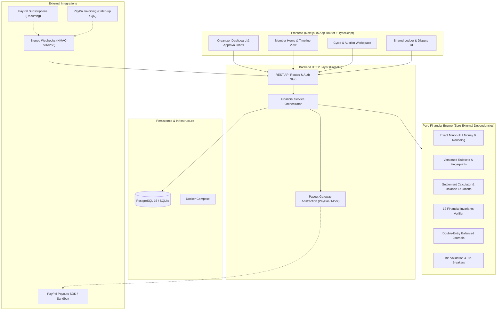

# ChitCircle — Operating System for Community Savings Circles

> **Product in one sentence:** ChitCircle helps community savings-circle organizers run collections, payout rules, auctions, records, and member communication from one shared system, with AI proposing actions and people approving anything that moves money.

ChitCircle is an organizer-first platform for community savings circles worldwide (Chit Funds, ROSCAs, Tandas, Susus, Committees). It eliminates tedious manual chasing and administrative disputes through a **deterministic financial engine**, an **append-only double-entry ledger**, a **PayPal sandbox integration**, and **assistive AI agents** operating under strict human-in-the-loop controls.

---

## Table of Contents

- [Core Principles](#core-principles)
- [What ChitCircle Is and Is Not](#what-chitcircle-is-and-is-not)
- [Target Users & Jobs to Be Done](#target-users--jobs-to-be-done)
- [System Architecture](#system-architecture)
- [Financial Engine & Settlement Model](#financial-engine--settlement-model)
  - [Settlement Lifecycle](#settlement-lifecycle)
  - [Supported Payout Modes](#supported-payout-modes)
  - [Mathematical Model & Canonical Example](#mathematical-model--canonical-example)
  - [The 12 Financial Invariants](#the-12-financial-invariants)
- [AI Agents & Assistive Architecture](#ai-agents--assistive-architecture)
- [PayPal Integration Architecture](#paypal-integration-architecture)
- [Repository Structure](#repository-structure)
- [Quickstart & Running Locally](#quickstart--running-locally)
  - [1. Database (PostgreSQL)](#1-database-postgresql)
  - [2. Backend (FastAPI + Financial Engine)](#2-backend-fastapi--financial-engine)
  - [3. Frontend (Next.js 15 App)](#3-frontend-nextjs-15-app)
- [API Lifecycle Walkthrough](#api-lifecycle-walkthrough)
- [Spec Section 20 — Reserved Decisions](#spec-section-20--reserved-decisions)
- [Known Limitations & Roadmap](#known-limitations--roadmap)

---

## Core Principles

1. **Organizer-First:** Designed around removing the heavy administrative burden of tracking contributions, late payments, auctions, and payouts.
2. **Rules Before AI:** Calculations, settlement, eligibility, deadlines, and bid validation are executed exclusively by deterministic, unit-tested code—never by language models.
3. **Humans Approve Money Actions:** AI can draft reminders, explain calculations, and highlight risk signals. It cannot independently release a payout, adjust an obligation, or move money.
4. **One Append-Only Record:** Financial events are immutably written to an append-only ledger. Corrections create linked reversal/dispute records rather than mutating history.
5. **Tiered Visibility:**
   - **Group View:** Cycle status, pot size, auction outcomes, and shared dividend distributions.
   - **Member Private View:** Personal transaction history, remaining obligations, and individual risk factors.
   - **Organizer View:** Full circle ledger, risk indicators, collateral/guarantor status, and approval queues.
6. **Configurable by Tradition and Jurisdiction:** Payout modes, auction discount caps, commissions, tie-breaks, security policies, and visibility settings are versioned ruleset configurations.
7. **Explainable Mathematics:** Every number shown on screen is traceable directly to input rules and immutable ledger entries.
8. **Honest Prototyping:** Sandbox transactions and synthetic simulations are clearly distinguished from live funds.

---

## What ChitCircle Is and Is Not

| What ChitCircle Is | What ChitCircle Is Not |
|---|---|
| **Software for organizers** to automate administration, auctions, and records | **Not a bank, wallet, or custodian** holding member funds |
| **Deterministic settlement calculator** enforcing mathematical balance | **Not a lender** or an operator of savings funds |
| **Audit trail & double-entry ledger** of obligations and payments | **Not a formal credit bureau** (does not issue credit scores) |
| **Human-in-the-loop copilot** proposing reminders and alerts | **Not an autonomous AI agent** moving funds or altering debts |

---

## Target Users & Jobs to Be Done

### Primary User: Circle Organizer
- **Job:** *"Help me run the circle fairly and on time without turning every month into an exhausting manual administrative burden."*
- **Key Capabilities:**
  - Real-time dashboard: who has paid, who is late, and upcoming deadlines.
  - Automated auction closes with deterministic tie-breaks and fallbacks.
  - One-tap approval inbox for proposed reminders, catch-up invoices, and payout releases.
  - Pre-payout guarantor/collateral verification workflows.

### Secondary User: Circle Member
- **Job:** *"Help me trust the process, understand my numbers, and track circle progress without having to ask the organizer."*
- **Key Capabilities:**
  - Clear contribution breakdown showing exact deductions from dividends.
  - Member timeline showing past and future cycle obligations.
  - Plain-language explainer translating ledger math into plain words.
  - Dispute flagging on ledger entries.

---

## System Architecture



---

## Financial Engine & Settlement Model

The financial engine lives in `backend/financial_engine/`. It is strictly decoupled from web frameworks, databases, and UI code (enforced via automated unit tests).

### Settlement Lifecycle

```
Calculate ──► Validate Invariants ──► Approve ──► Execute Payout ──► Reconcile ──► Finalize
```

1. **Calculate:** Pure calculation runs on versioned ruleset and cycle inputs.
2. **Validate:** The 12 financial invariants are checked against the candidate settlement.
3. **Approve:** Required approvals are recorded (organizer/approver cannot be the winner).
4. **Execute Payout:** Idempotent gateway dispatch (`payout:{settlement_id}`).
5. **Reconcile:** Provider webhooks and payment allocations match obligations and payout confirmations.
6. **Finalize:** Settlement seals only when all ledger journals balance and the circle pool nets to zero.

### Supported Payout Modes

1. **Auction with Dividend (Discount-Funded):** Highest valid discount wins the pot; commission is deducted from discount; balance forms dividend pool returned to members.
2. **Fixed Rotation (No-Discount):** Predetermined order of payout each cycle; full chit value minus fixed commission.
3. **Auditable Lottery:** Deterministic pseudo-random draw using a committed SHA-256 seed verifiable by all participants.
4. **Agreed-Discount Early Payout:** Member requests early payout at a negotiated discount with circle consent; settles through the same math engine.

### Mathematical Model & Canonical Example

- **Discount-Funded:**
  $$W = V - D$$
  $$P = D - F$$
  $$\sum \text{net\_contributions} = W + F + R$$
- **No-Discount:**
  $$W = V - F, \quad P = 0, \quad \sum \text{net\_contributions} = W + F$$

Where:
- $V$ = Total chit value
- $D$ = Winning bid discount
- $W$ = Winner payout
- $F$ = Organizer commission
- $P$ = Total dividend pool
- $R$ = Explicit rounding remainder ($R < N$ minor units) allocated to configured destination

#### Canonical Worked Example (₹1,00,000 Chit Fund)
This test case runs as a permanent regression test (`tests/test_settlement.py::test_worked_example_regression`):

| Parameter | Formula | Amount |
|---|---|---:|
| Chit Value ($V$) | Base pool | ₹1,00,000 |
| Members ($N$) | Circle size | 20 |
| Gross Installment ($C$) | $V / N$ | ₹5,000 |
| Winning Discount ($D$) | Auction outcome | ₹12,000 |
| **Winner Payout ($W$)** | $V - D$ | **₹88,000** |
| Organizer Commission ($F$) | Configured rule | ₹5,000 |
| Dividend Pool ($P$) | $D - F$ | ₹7,000 |
| Dividend per Member ($d$) | $P / N$ | ₹350 |
| **Net Installment per Member** | $C - d$ | **₹4,650** |
| **Reconciliation Equation** | $20 \times ₹4,650 = ₹93,000$ | $₹88,000 (W) + ₹5,000 (F)$ |

### The 12 Financial Invariants

Implemented in `backend/financial_engine/validation.py`, these checks run on every settlement:

1. `CURRENCY_MISMATCH`: All monetary amounts match the circle currency.
2. `RULESET_MISMATCH`: Ruleset version and SHA-256 fingerprint match cycle configuration.
3. `NEGATIVE_ALLOCATION`: No negative amounts allowed.
4. `CHIT_VALUE_MISMATCH`: Settlement chit value equals ruleset total.
5. `COMMISSION_MISMATCH` / `COMMISSION_INVALID`: Commission matches ruleset definition.
6. `WINNER_PAYOUT_FORMULA`: Winner payout matches expected formula for payout mode.
7. `DIVIDEND_POOL_FORMULA`: Dividend pool accurately reflects discount less commission.
8. `DIVIDENDS_DO_NOT_RECONCILE`: Sum of dividends + rounding remainder equals dividend pool.
9. `REMAINDER_DESTINATION_MISSING`: If $R > 0$, an explicit remainder destination must be configured.
10. `CONTRIBUTIONS_DO_NOT_SUM_TO_CHIT_VALUE`: Member obligations sum to $V$.
11. `NET_CONTRIBUTION_MISMATCH`: Net contribution equals gross obligation minus dividend for each member.
12. `BALANCE_EQUATION` & `WINNER_ALREADY_WON`: Total net contributions equal $W + F + R$, and a member can only win once.

---

## AI Agents & Assistive Architecture

AI agents assist organizers and members with structured tools and verified ledger context, governed by strict guardrails:

- **Collections Agent:** Drafts polite reminders and escalation notices; proposes catch-up invoices for overdue members; never marks debts paid without cryptographic or provider evidence.
- **Bid Advisor:** Contextualizes proposed bids against historical cycle data; calculates exact take-home payouts; never submits bids on behalf of members.
- **Ledger Explainer:** Generates plain-language breakdowns of installments and settlements backed by direct references to ledger entries.
- **Organizer Copilot:** Summarizes cycle health, open approvals, upcoming deadlines, and risk flags.
- **Rule-Based Risk Indicators:** Transparent scoring based on payment timing, completed cycles, and collateral status; accompanied by human-readable reason codes; strictly non-punitive.

---

## PayPal Integration Architecture

ChitCircle leverages PayPal sandbox primitives across the cycle lifecycle:

- **Recurring Contributions:** PayPal Subscriptions & Billing Plans for regular cycle contributions.
- **Catch-Up & Arrears:** PayPal Invoicing API with QR-code support for late contributions.
- **Transaction Webhooks:** Signed provider callbacks via `POST /webhooks/provider` verified with HMAC-SHA256 signatures (`X-Signature`).
- **Payout Gateway Abstraction:** `PayoutGateway` interface with:
  - `MockGateway`: Fast local testing and deterministic mock responses.
  - `PayPalPayoutsGateway`: Batch payout sandbox integration using idempotency keys (`payout:{settlement_id}`).
- **Provider Reconciliation:** Independent reconciliation ledger matching provider transaction IDs against cycle obligations.

---

## Repository Structure

```
chitcircle/
├── ChitCircle_Product_Blueprint.md   # Core product specification & hackathon blueprint
├── README.md                          # This document
├── docker-compose.yml                 # Local PostgreSQL 16 service
├── backend/
│   ├── financial_engine/              # PURE mathematical calculations (no DB, no FastAPI)
│   │   ├── money.py                   # Integer minor units, currency, explicit rounding
│   │   ├── rules.py                   # Immutable, versioned rulesets & fingerprinting
│   │   ├── contributions.py           # Contribution obligation calculations
│   │   ├── auction.py                 # Bid validation, eligibility, tie-breakers
│   │   ├── payout_modes.py            # Rotation, lottery, early payout modes
│   │   ├── settlement.py              # Settlement math (W, F, P, dividends, remainder)
│   │   ├── validation.py              # The 12 financial invariants
│   │   ├── states.py                  # Cycle state machine (ON_HOLD, DISPUTED, etc.)
│   │   ├── ledger.py                  # Balanced double-entry journals & chart of accounts
│   │   ├── reconciliation.py          # Provider reconciliation & HMAC callback verifier
│   │   └── risk.py                    # Transparent rule-based risk indicators
│   ├── app/                           # FastAPI application layer
│   │   ├── api/routes.py              # HTTP endpoints & auth stub
│   │   ├── models.py                  # SQLAlchemy ORM models & append-only triggers
│   │   ├── schemas.py                 # Pydantic request/response schemas
│   │   └── services/                  # Orchestration, ledger service, gateway abstraction
│   ├── tests/                         # Pytest suite: unit, Hypothesis property, integration
│   └── requirements.txt               # Backend dependencies
└── frontend/                          # Next.js 15 (App Router) + TypeScript
    ├── src/
    │   ├── app/                       # Routes: /welcome, /app/home, /app/circles, etc.
    │   ├── components/                # Accessible, mobile-first design token UI components
    │   └── lib/                       # API client, money formatting, permissions stub
    ├── tests/                         # Vitest + React Testing Library suite
    └── package.json                   # Frontend dependencies
```

---

## Quickstart & Running Locally

### Prerequisites
- Python 3.11+
- Node.js 18+ & npm
- Docker & Docker Compose

### 1. Database (PostgreSQL)

Start the local PostgreSQL container:
```bash
docker compose up -d
```
*Note: Backend integration tests run on an in-memory SQLite database by default, so Docker is optional for running `pytest`.*

### 2. Backend (FastAPI + Financial Engine)

```bash
cd backend

# Create virtual environment and install dependencies
python -m venv .venv
# Linux / macOS:
source .venv/bin/activate
# Windows:
.venv\Scripts\activate

pip install -r requirements.txt

# Run the automated test suite (86+ unit, property-based, and API tests)
pytest

# Configure environment and run development server
cp .env.example .env
uvicorn app.main:app --reload --port 8000
```
Interactive OpenAPI documentation is available at `http://localhost:8000/docs`.

### 3. Frontend (Next.js 15 App)

```bash
cd frontend

# Install dependencies
npm install

# Run the test suite (64+ tests)
npm test

# Start the Next.js dev server (runs in standalone demo mode or connected to backend)
npm run dev
```
Open `http://localhost:3000` in your browser. Demo mode operates out-of-the-box without requiring a running backend.

To connect the frontend to the live backend:
1. Copy `.env.example` to `.env.local` in `frontend/`.
2. Ensure `CHITCIRCLE_API_URL=http://localhost:8000` is set.
3. Access `/sign-in` (dev mode) and supply an actor ID (e.g. `organizer_1`).

---

## API Lifecycle Walkthrough

```bash
# 1. Create a Circle with versioned ruleset and members
curl -X POST http://localhost:8000/circles \
  -H "X-Actor-Id: org_1" -H "X-Actor-Role: organizer" \
  -H "Content-Type: application/json" \
  -d '{"name": "Savings Circle A", "ruleset": {...}, "members": ["m1", "m2", "m3"]}'

# 2. Open a Cycle and issue contribution obligations
curl -X POST http://localhost:8000/circles/{circle_id}/cycles \
  -H "X-Actor-Id: org_1" -H "X-Actor-Role: organizer" -d '{"due_date": "2026-11-01"}'
curl -X POST http://localhost:8000/cycles/{cycle_id}/open \
  -H "X-Actor-Id: org_1" -H "X-Actor-Role: organizer"

# 3. Open Auction, submit bids, and close
curl -X POST http://localhost:8000/cycles/{cycle_id}/auction/open \
  -H "X-Actor-Id: org_1" -H "X-Actor-Role: organizer"
curl -X POST http://localhost:8000/cycles/{cycle_id}/auction/bids \
  -H "X-Actor-Id: m1" -H "X-Actor-Role: member" \
  -d '{"member_id": "m1", "discount": 1200000}'
curl -X POST http://localhost:8000/cycles/{cycle_id}/auction/close \
  -H "X-Actor-Id: org_1" -H "X-Actor-Role: organizer"

# 4. Calculate Settlement (deterministic and idempotent)
curl -X POST http://localhost:8000/cycles/{cycle_id}/settlement \
  -H "X-Actor-Id: org_1" -H "X-Actor-Role: organizer"

# 5. Approve & Dispatch Payout
curl -X POST http://localhost:8000/settlements/{settlement_id}/approvals \
  -H "X-Actor-Id: approver_1" -H "X-Actor-Role: approver" \
  -d '{"decision": "APPROVED", "reason": "Verified collateral"}'
curl -X POST http://localhost:8000/settlements/{settlement_id}/payout \
  -H "X-Actor-Id: org_1" -H "X-Actor-Role: organizer"

# 6. Finalize Settlement (validates double-entry ledger & reconciliation)
curl -X POST http://localhost:8000/settlements/{settlement_id}/finalize \
  -H "X-Actor-Id: org_1" -H "X-Actor-Role: organizer"
```

---

## Spec Section 20 — Reserved Decisions

In accordance with Section 20 of the specification, all ambiguous policy decisions are formalized as explicit configuration parameters rather than hard-coded heuristics:

| Open Item | How the Implementation Treats It |
|---|---|
| **Default commission base & rate** | No default: `commission.base` and `rounding` are required ruleset fields. |
| **Rounding method & remainder destination** | Explicit method required; remainder destination is required at runtime if a dividend remainder occurs. |
| **Default grace period** | No implicit grace: `grace_period_days` must be defined in the ruleset. |
| **Tie-break & lottery audit** | Configurable: `EARLIEST_BID`, `LOWEST_POSITION`, or `SEEDED_RANDOM`. Lottery uses a committed SHA-256 seed. |
| **Dividend eligibility** | Implemented as: "members not in arrears past grace period at calculation time." |
| **Approval policy** | Strict `required_approvals` threshold (≥ 1); winner cannot approve their own payout. |
| **Chart of accounts** | Minimal double-entry ledger chart modeled in `backend/financial_engine/ledger.py`. |
| **Jurisdiction profiles** | Profile stored in ruleset; serves as configuration bounds without claiming legal compliance. |
| **PayPal Sandbox Payouts** | Abstracted behind `PayoutGateway`; HMAC-SHA256 signature verifier for webhooks. |
| **Disputes & chargebacks** | Cycles transition to `DISPUTED` or `FAILED`; resume returns to prior state. |

---

## Known Limitations & Roadmap

- **Database Concurrency:** Row locks (`SELECT ... FOR UPDATE`), append-only triggers, and unique constraints are designed for PostgreSQL. While SQLite handles in-memory testing, production deployment requires PostgreSQL.
- **Authentication:** Current API uses `X-Actor-Id` and `X-Actor-Role` header stubs; production requires JWT/OIDC authentication.
- **Alembic Migrations:** Database schemas are currently generated via SQLAlchemy `create_all` on startup.
- **Implementation Status:**
  - **Phase 1 & 2 (Complete):** Core financial engine, 12 invariants, append-only double-entry ledger, Next.js app shell, read-only circle/round views, mobile-first design system.
  - **Phase 3–5 (In Progress):** Interactive frontend write actions (bidding, one-tap approvals), live PayPal sandbox webhook verification, and automated fast-forward simulation.

---

## License

This project was built for the PayPal AI Hackathon. See repository license details for terms.
