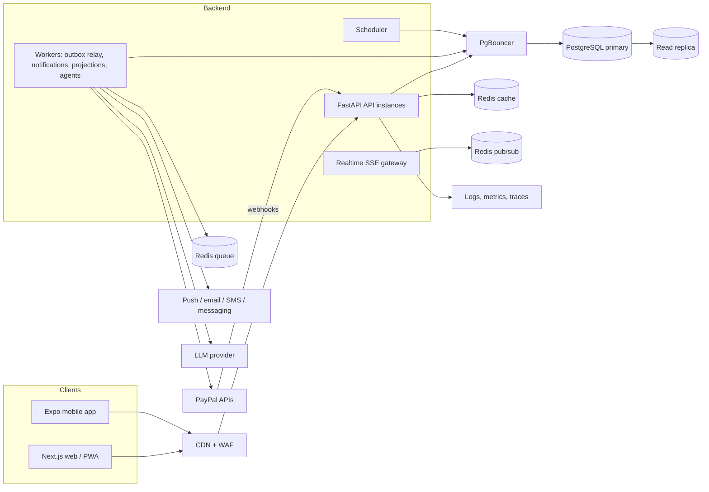

# 02. System Architecture

## 1. Shape of the system

A **modular monolith** (one FastAPI codebase, deployed as several process types) plus managed data services. Module boundaries are enforced in code and by tests so that any module can be extracted later if a trigger fires.



## 2. Process types

| Process | Responsibility | Scales on |
|---|---|---|
| **API** | HTTP, authn/z, validation, calls the service layer, short transactions | CPU, request rate |
| **Webhook receiver** (a route group of the API, can be split) | Verify signature, persist raw event, acknowledge fast | Request rate |
| **Worker** | Outbox relay, webhook processing, PayPal calls, notifications, projections, agent runs | Queue depth |
| **Scheduler** | Opens cycles, closes auctions, schedules reminders, runs nightly reconciliation | Single leader, lock-protected |
| **Realtime gateway** | SSE or WebSocket fan-out for live auctions | Connections |

## 3. Module boundaries inside the monolith

| Module | Owns | May call |
|---|---|---|
| `identity` | Users, sessions, roles, phone/email, consent | none |
| `circles` | Circles, members, rulesets, presets | `identity` |
| `engine` | Pure calculation (existing `financial_engine/`) | nothing (enforced by the purity test) |
| `ledger` | Events, journals, balances, outbox | `engine` types |
| `cycles` | Cycle state machine, auctions, bids, early payout | `engine`, `ledger` |
| `payments` | Gateway interfaces, PayPal adapter, webhooks, reconciliation | `ledger`, `cycles` |
| `notifications` | Channels, preferences, templates, delivery log | `identity` |
| `risk` | Indicators and scores (advisory) | `ledger` (read) |
| `agents` | Proposed actions, agent runs, tools | read APIs, `cycles` (via approvals) |
| `readmodels` | Projections and cached views | `ledger` events |

Rules: no module imports another's database models; cross-module calls go through service interfaces; read models are the only place that joins across modules.

## 4. Key flows

### 4.1 Contribution collection

1. `cycles` opens a cycle and creates one obligation per member (existing behaviour).
2. Scheduler enqueues reminders at configured offsets, with jitter.
3. Member pays through a PayPal-hosted flow (invoice, order or subscription).
4. PayPal sends a webhook. The receiver verifies the signature, stores the raw event with a unique provider event id, returns 200, and enqueues processing.
5. A worker maps the event to an obligation, takes the cycle row lock, appends a `PAYMENT` ledger event and an outbox row in **one transaction**.
6. The outbox relay triggers projections (timeline, dashboard), notifications and agents.

### 4.2 Auction

1. Organizer opens the auction. Members submit bids (`POST`, authoritative, short transaction under the cycle row lock).
2. Live view: clients subscribe to SSE; Redis pub/sub broadcasts a "bid count changed" signal. Bid amounts stay hidden in sealed mode.
3. The scheduler closes the auction at the deadline under the same lock. The engine picks the winner and applies tie-break rules.
4. Settlement is calculated once (unique constraint), then goes to approvals.

### 4.3 Payout

1. Settlement is approved by the required approvers (not the recipient).
2. A worker calls the gateway **outside any DB transaction**, with idempotency key `payout:{settlement_id}`.
3. Outcome is `CONFIRMED`, `FAILED` or `UNKNOWN`. `UNKNOWN` leaves the cycle in `PAYOUT_PENDING` and a checker job polls until resolved.
4. Provider webhooks confirm; reconciliation compares the provider record to the ledger; finalize only succeeds when everything balances (existing behaviour).

## 5. API conventions

- Versioned prefix `/v1`. Breaking changes get `/v2`; additive changes do not.
- `Idempotency-Key` header required on every state-changing endpoint; stored with the response for 24 hours or more.
- Cursor pagination, never offset, for ledger and notification lists.
- Errors as RFC 9457 problem details with a stable `code`.
- `ETag` on read-model endpoints, derived from the circle's ledger sequence (see `04`).
- OpenAPI is the contract. Web and mobile clients are generated from it.

## 6. Sync versus async database access

The prototype uses synchronous SQLAlchemy. **Keep it.** FastAPI runs sync endpoints in a thread pool, and horizontal scaling plus short transactions is enough at the targets in `01`. Revisit only if profiling shows thread-pool saturation. A rewrite to async would add risk to the most sensitive code for little gain.

## 7. Repository layout (target)

```
chitcircle/
  apps/
    api/            FastAPI app, workers, scheduler (one codebase, several entrypoints)
    web/            Next.js
    mobile/         Expo
  packages/
    api-client/     generated TypeScript client from OpenAPI
    ui-tokens/      shared design tokens, formatting helpers
  infra/            Terraform, deployment config
  docs/
```
