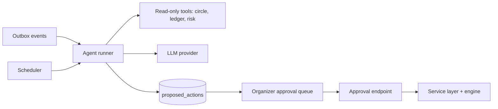

# 10. AI Agents

## 1. Role and boundaries

Agents reduce the organizer's workload. They **observe, explain, draft and propose**. They never calculate money, never execute a money-moving action directly, and never hold credentials.

| Allowed | Not allowed |
|---|---|
| Read circle state through read-only tools | Compute settlement, dividends, rates or balances |
| Draft reminder wording within approved templates | Send money or approve anything |
| Explain a number that the engine already produced | Change rulesets or member security status |
| Create a **proposed action** for a human | Call provider APIs |
| Summarize and prioritize | Access raw PII beyond what a task needs |

All numbers shown by an agent come from engine or ledger output injected into the prompt, and are checked against it before sending.

## 2. Agents

| Agent | Trigger | Output |
|---|---|---|
| **Collections** | Scheduler plus outbox events (obligation overdue) | Reminder messages; proposed catch-up invoice; proposed organizer alert |
| **Bid advisor** | Member opens the auction screen | "If you bid 14% you receive X; typical winning bids here were 10 to 13%" (from engine and history) |
| **Explainer** | Member asks "why is my installment X?" | Plain-language breakdown built from the settlement record |
| **Organizer copilot** | Daily schedule | Summary: who is late, pending approvals, money at risk, next actions |
| **Risk watcher** | Ledger events | Raises a proposed action when a prized member's risk indicators worsen |

## 3. Architecture

- **Proposed action lifecycle:** `PROPOSED` then `APPROVED` or `REJECTED` then `EXECUTED` or `FAILED`. Only `APPROVED` actions run, and only through the existing service layer, which re-validates everything.
- **Standing policies** ("auto-approve reminders", "always send a gentle nudge on day 1") are explicit, versioned organizer settings, and still pass the same validation. Money-moving actions never get standing auto-approval in the first release.
- **Orchestration:** keep the escalation **schedule deterministic** in the scheduler (day 1 reminder, day 3 follow-up, day 7 catch-up invoice, day 10 organizer alert). The LLM only personalizes wording and explains. LangGraph or a plain state machine is fine for multi-step runs; the existing state-machine discipline carries over.

## 4. Guardrails

1. **Structured output:** responses must validate against a JSON schema; invalid output triggers one retry, then a template fallback.
2. **Fact check:** every number in a message is compared to the engine output; mismatch blocks sending.
3. **Prompt injection defense:** member-written text (notes, dispute reasons) is untrusted data, delimited, never treated as instructions; agents have no tools that can act on it.
4. **PII minimization and redaction** before sending anything to the provider.
5. **Tone policy:** no threats, no shaming, no legal claims; escalation is firmness plus clarity.
6. **Rate limits** per circle and per member (no message storms).
7. **Kill switch:** a feature flag disables each agent instantly.
8. **Audit:** prompt version, model, inputs hash, output, and decision are stored.

## 5. Cost and performance control

- Use a **small, fast model** for classification and wording; reserve larger models for rare explainers.
- **Cache** explanations by hash of inputs (settlement fingerprint plus question type) for 24 hours.
- **Batch** daily summaries per circle; do not call the model per ledger event.
- Template-first design: most reminders are 90% template; the model fills only tone and one personalized line.
- Budgets and alerts on daily spend; degrade to templates when the budget is exhausted.
- Run agents on the lowest-priority queue so they cannot delay payments.

## 6. Evaluation

- A fixed evaluation set per agent: realistic situations with expected facts, tone constraints and forbidden content.
- Automated checks: numeric fidelity, schema validity, banned phrases, language correctness.
- Human review sample of live outputs each week in the first months.
- Track: acceptance rate of proposed actions, edits made by organizers, opt-outs after messages, and time saved.

## 7. Multilingual behaviour

Agents write in the member's chosen language using approved templates per language; free-form generation is allowed only where the language has been evaluated. Currency, date and number formatting come from locale libraries, not the model.

## 8. Roadmap

- **Phase 1:** collections agent and explainer on the simulator, proposed actions with one-tap approval.
- **Phase 3:** organizer copilot, bid advisor, caching and cost controls.
- **Phase 4:** multilingual templates, channel-aware messaging.
- **Phase 5+:** risk watcher tuned on real behaviour, with transparent weights and human override.
