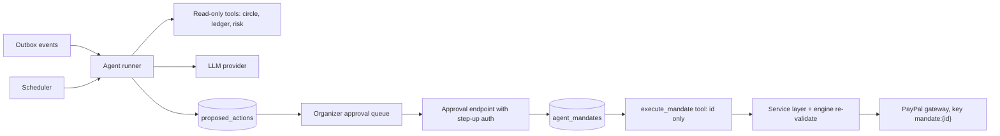

# 10. AI Agents

## 1. Role and boundaries

Agents reduce the organizer's workload. The rule for this project is:

> **The LLM decides what to propose. Deterministic code decides what executes. An agent may execute a
> payment-related action only after explicit human approval, through a single-use mandate that locks the
> exact parameters.**

Agents still **never calculate money** (every number comes from the engine), never act without approval,
and never hold provider credentials. Execution is approval-gated and mandate-locked, not open-ended.

| Allowed | Not allowed |
|---|---|
| Read circle state through read-only tools | Compute settlement, dividends, rates or balances |
| Draft reminder wording within approved templates | Act without explicit human approval (no unapproved, unmandated calls) |
| Explain a number that the engine already produced | Supply amount, recipient or any execution parameter |
| Create a **proposed action** with exact structured parameters | Change rulesets or member security status |
| Execute an approved, mandate-locked action through `execute_mandate(mandate_id)` | Hold provider credentials or call raw provider APIs |
| Report the outcome and follow up | Access raw PII beyond what a task needs |

All numbers shown by an agent come from engine or ledger output injected into the prompt, and are checked
against it before sending. Amounts actually executed are **recomputed by the engine** from stored mandate
parameters, never taken from the model.

Custody note: this is compatible with `adr/0002`. Non-custodial concerns *where money sits*, not who
triggers the call; an agent acting from the organizer's own payment account after approval does not create
custody. PayPal's acceptable use policy applies equally to agent and non-agent calls (**VERIFY**).

## 2. Agents

| Agent | Trigger | Output |
|---|---|---|
| **Collections** | Scheduler plus outbox events (obligation overdue) | Reminder messages; proposed catch-up invoice; after one-tap approval it executes and creates the invoice through PayPal; proposed organizer alert |
| **Bid advisor** | Member opens the auction screen | "If you bid 14% you receive X; typical winning bids here were 10 to 13%" (from engine and history) |
| **Explainer** | Member asks "why is my installment X?" | Plain-language breakdown built from the settlement record |
| **Organizer copilot** | Daily schedule | Summary: who is late, pending approvals, money at risk, next actions |
| **Risk watcher** | Ledger events | Raises a proposed action when a prized member's risk indicators worsens |
| **Payout executor** | Settlement reaches `APPROVED` and a mandate is issued | Executes the winner payout through `execute_mandate`; reports outcome and follows up via the `UNKNOWN` checker flow |

Agents that never execute (explainer, bid advisor, copilot, risk watcher) remain read-only and
proposal-only.

## 3. Architecture: proposals and the mandate model

### 3.1 The mandate design

1. **Propose.** The agent writes a `proposed_actions` row with exact structured parameters: kind,
   recipient member id, amount (integer minor units), currency, circle id, cycle or settlement id,
   rationale, expiry.
2. **Approve.** A human approves with step-up auth (biometric or OTP). The approval screen shows the exact
   amount and recipient in plain language.
3. **Issue.** Approval creates a **mandate**: hash of canonical parameters, single use, short expiry, hard
   amount cap, bound to circle, cycle, recipient and action kind.
4. **Execute.** The agent calls `execute_mandate(mandate_id)`. This tool takes **only** the id. The LLM
   never supplies amount or recipient. The tool re-reads parameters from the database, verifies hash,
   expiry, unused status and proposal state, recomputes the amount with the engine and aborts on any
   mismatch, takes the cycle lock, then calls the gateway with idempotency key `mandate:{id}`. Provider
   calls stay outside DB transactions; `UNKNOWN` outcomes use the existing checker flow.
5. **Report.** The agent reports the outcome and follows up: confirmation, rescheduling, or escalation to
   the organizer.

The mandate table (`agent_mandates`) is defined in `03-data-model-and-consistency.md`; the gateway path is
in `06-paypal-integration.md`.

### 3.2 Lifecycle

`PROPOSED -> APPROVED -> MANDATE_ISSUED -> EXECUTED | FAILED | EXPIRED | REVOKED`

| State | Meaning |
|---|---|
| `PROPOSED` | Agent created the row; nothing can execute yet |
| `APPROVED` | A human approved with step-up; mandate about to be / being issued |
| `MANDATE_ISSUED` | Single-use mandate exists, parameters hash-locked, expiry clock running |
| `EXECUTED` | Gateway call completed (`UNKNOWN` handed to the checker flow) |
| `FAILED` | Execution aborted: validation, hash, expiry, cap or provider failure |
| `EXPIRED` | Mandate passed `expires_at` unused |
| `REVOKED` | A human revoked the mandate before execution |

A rejection ends at `PROPOSED` and issues no mandate. Only `MANDATE_ISSUED` can reach `EXECUTED`, and only
once.

### 3.3 Execution agents

- **Collections agent (execution).** Proposes a catch-up invoice for an overdue obligation; after one-tap
  approval and mandate issue, executes it so the invoice is created on the organizer's own PayPal account;
  then tracks payment through the webhook and confirms.
- **Payout executor (execution).** Once a settlement is `APPROVED` (approval + step-up + second approver)
  and the mandate is issued, executes the winner payout through `execute_mandate`, then follows up with the
  `UNKNOWN` checker flow and reconciliation.

### 3.4 Standing policies and orchestration

- **Standing policies** ("auto-approve reminders", "always send a gentle nudge on day 1") are explicit,
  versioned organizer settings, and still pass the same validation. In v1 standing auto-approval covers
  **Tier 0 messages only**; Tier 2 payouts never get standing auto-approval; standing policies for small
  catch-up invoices (Tier 1) may come later.
- **Orchestration:** keep the escalation **schedule deterministic** in the scheduler (day 1 reminder, day 3
  follow-up, day 7 catch-up invoice, day 10 organizer alert). The LLM only personalizes wording, explains
  and proposes; when an action is due, deterministic code issues the mandate after approval. LangGraph or a
  plain state machine is fine for multi-step runs; the existing state-machine discipline carries over.

## 4. Guardrails

1. **Structured output:** responses must validate against a JSON schema; invalid output triggers one retry,
   then a template fallback.
2. **Fact check:** every number in a message is compared to the engine output; mismatch blocks sending.
3. **Prompt injection defense:** member-written text (notes, dispute reasons) is untrusted data, delimited,
   never treated as instructions, and it **never reaches the execution path** — `execute_mandate` reads only
   stored mandate parameters, and the model cannot supply amount or recipient.
4. **PII minimization and redaction** before sending anything to the provider.
5. **Tone policy:** no threats, no shaming, no legal claims; escalation is firmness plus clarity.
6. **Rate limits** per circle and per member (no message storms).
7. **Kill switch:** global and per-agent feature flags disable proposal or execution instantly; a kill
   switch halts all in-flight mandate executions.
8. **Audit:** prompt version, model, inputs hash, output, proposal, rationale, approver, device, mandate
   and result are stored.

### 4.1 Layered execution guardrails

| Layer | Rule |
|---|---|
| **Action allow-list** | Payout to the winner of an approved settlement, catch-up invoice, refund of a verified overpayment. There is no generic "pay X" action. |
| **Recipient rules** | Only circle members with a verified payout destination; cooldown and step-up after a destination change. |
| **Limits** | Per-action cap, per-circle daily cap, velocity limits, and global / per-agent kill switches (feature flags). |
| **Risk tiers** | See below. |
| **Isolation** | The LLM process holds no provider credentials; execution runs in a restricted worker; member-written text never reaches the execution path; mandate parameters come only from structured data. |
| **Provider tools** | If PayPal MCP tools are exposed to the agent, they sit behind a proxy that permits only mandated calls. Never give the LLM raw provider tools. |
| **Existing safety nets** | Idempotency, `UNKNOWN` handling, reconciliation and immutable audit (proposal, rationale, approver, device, mandate, result) apply unchanged. |

**Risk tiers**

| Tier | Actions | Approval |
|---|---|---|
| 0 | Messages, reminders, explanations | None, or an explicit standing policy |
| 1 | Invoices and refunds of a verified overpayment | One-tap approval (step-up confirmation), single mandate |
| 2 | Payouts | Approval + step-up + second approver; the recipient can never approve their own payout |

No standing auto-approval for payouts in v1; standing policies only for small catch-up invoices, later.

## 5. Cost and performance control

- Use a **small, fast model** for classification and wording; reserve larger models for rare explainers.
- **Cache** explanations by hash of inputs (settlement fingerprint plus question type) for 24 hours.
- **Batch** daily summaries per circle; do not call the model per ledger event.
- Template-first design: most reminders are 90% template; the model fills only tone and one personalized line.
- Budgets and alerts on daily spend; degrade to templates when the budget is exhausted.
- Run agents on the lowest-priority queue so they cannot delay payments.

## 6. Evaluation

- A fixed evaluation set per agent: realistic situations with expected facts, tone constraints and forbidden content.
- Automated checks: numeric fidelity, schema validity, banned phrases, language correctness.
- Human review sample of live outputs each week in the first months.
- Track: acceptance rate of proposed actions, edits made by organizers, opt-outs after messages, and time saved.

## 7. Multilingual behaviour

Agents write in the member's chosen language using approved templates per language; free-form generation is allowed only where the language has been evaluated. Currency, date and number formatting come from locale libraries, not the model.

## 8. Roadmap

- **Phase 1:** collections agent and explainer on the simulator; `proposed_actions` and `agent_mandates`;
  approval UI with step-up; `execute_mandate` execution through the PayPal sandbox (invoice first, then
  payout); caps, velocity limits and kill switch; mandate tests from `11`.
- **Phase 3:** organizer copilot, bid advisor, caching and cost controls; standing policies for small
  catch-up invoices (Tier 1).
- **Phase 4:** multilingual templates, channel-aware messaging.
- **Phase 5+:** risk watcher tuned on real behaviour, with transparent weights and human override.
