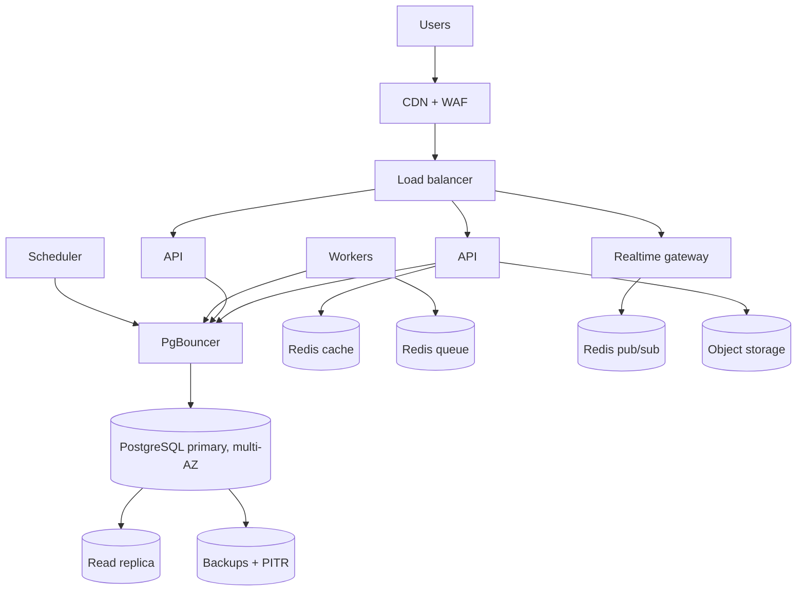

# 12. Infrastructure and Deployment

## 1. Environments

| Environment | Purpose | Data |
|---|---|---|
| Local | Development with Docker Compose (Postgres, Redis) | Seeded presets |
| Preview | One per pull request | Synthetic |
| Staging | Production-like, PayPal sandbox | Synthetic plus simulator |
| Production | Real users | Real; PayPal live after approvals |

## 2. Hackathon topology (Phase 1) on Render

| Component | Render resource | Notes |
|---|---|---|
| API | Web service (FastAPI, Uvicorn behind Gunicorn) | Health check on `/health`; env vars for secrets |
| Worker and relay | Background worker | Polls outbox and processes provider events |
| Scheduled jobs | Cron job or Render Workflows | Monthly cycle simulation, reminders, reconciliation |
| Database | Managed PostgreSQL | Enable backups |
| Cache | Managed Key Value (Redis-compatible) | Optional in Phase 1 |
| Web | Static or web service for Next.js | Or Vercel |

Keep it deliberately small: one API instance, one worker, one database. Add the Postman collection and a monitor against the deployed API.

## 3. Production topology (Phases 3 to 6)

Initial sizing at 100k users (validate with load tests): 2 to 4 API instances, 2 to 4 workers, 1 scheduler, 1 realtime gateway, one primary database with one replica, three small Redis instances, PgBouncer. Autoscale API on CPU and request latency, workers on queue depth.

## 4. Infrastructure as code

- **Terraform** for all cloud resources (network, database, cache, object storage, DNS, WAF, secrets, monitoring), in `infra/`, with remote state and environment workspaces.
- Containers built in CI from a single Dockerfile per process type; images are immutable and scanned.
- No manual console changes; drift detection on a schedule.
- Move to a larger cloud (AWS, GCP or Azure) when managed-service needs outgrow the hackathon host; keep the application cloud-neutral (containers, Postgres, Redis, S3-compatible storage).

## 5. CI/CD

1. Pull request: lint, type check, unit and property tests, Postgres integration tests, OpenAPI diff, generated-client check, security scans, preview environment.
2. Merge to main: build images, run migrations in staging, run the Postman or Newman suite and smoke tests.
3. Production: manual approval, **expand-and-contract migrations first**, then rolling or blue-green deploy, automated smoke test, instant rollback on failure.
4. Feature flags (for example Unleash or a managed provider) separate deploy from release.

## 6. Configuration and secrets

- Twelve-factor configuration through environment variables; secrets in a secrets manager and injected at runtime.
- Separate credentials for sandbox and live; rotation runbook.
- Config is typed and validated at startup; the app refuses to boot with missing critical settings (the prototype already rejects all callbacks if the webhook secret is unset).

## 7. Cost awareness

- Biggest cost drivers at scale: managed database, messaging (SMS and message-app channels), LLM usage, and observability data volume.
- Controls: sampling for traces, log retention tiers, template-first agents, push before SMS, budget alerts per service.
- Track cost per active circle and per settled cycle as a product metric.

## 8. Regional strategy

- Start single-region near the largest user base with multi-AZ.
- Phase 5: evaluate region pinning where data-protection law requires it.
- Phase 6: warm standby region with replicated database and a rehearsed failover.
