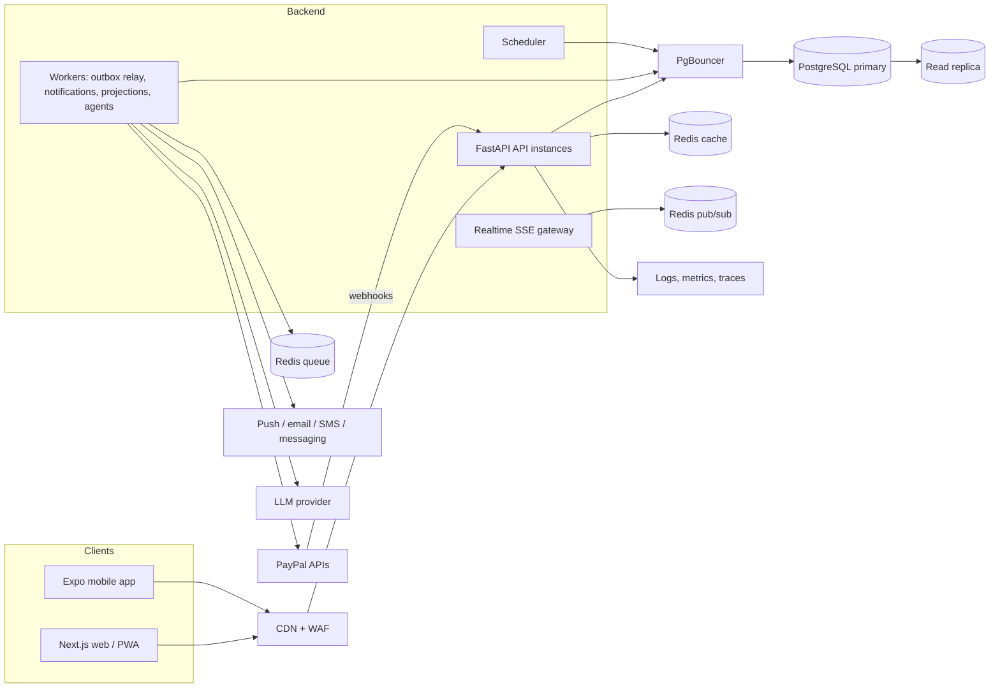

# ChitCircle Backend — Comprehensive Implementation Specification

> **Single-source reference for building and operating the scalable, durable ChitCircle backend.**
> Synthesises the full design corpus (`01`–`12`, six ADRs, seven phase plans, appendix) **and** the current
> `backend/` prototype, so every section states both the target design and the current state of the code.
> Anything marked **VERIFY** is an assumption or external fact that must be confirmed before it is relied upon.
> Anything marked **GAP** is a concrete difference between the current prototype and the target design.

---

## Table of contents

1. [Purpose, scope and how to read this document](#1-purpose-scope-and-how-to-read-this-document)
2. [Product and domain primer](#2-product-and-domain-primer)
3. [Non-functional requirements and capacity model](#3-non-functional-requirements-and-capacity-model)
4. [Architecture](#4-architecture)
5. [The money core (the financial engine contract)](#5-the-money-core-the-financial-engine-contract)
6. [Data model](#6-data-model)
7. [Consistency, locking and idempotency](#7-consistency-locking-and-idempotency)
8. [Caching and read models](#8-caching-and-read-models)
9. [Asynchronous processing, events, scheduling and realtime](#9-asynchronous-processing-events-scheduling-and-realtime)
10. [Payments and PayPal integration](#10-payments-and-paypal-integration)
11. [Security, privacy and compliance (backend)](#11-security-privacy-and-compliance-backend)
12. [Observability and reliability](#12-observability-and-reliability)
13. [AI agents backend](#13-ai-agents-backend)
14. [API conventions and endpoint inventory](#14-api-conventions-and-endpoint-inventory)
15. [Testing strategy](#15-testing-strategy)
16. [Infrastructure and deployment](#16-infrastructure-and-deployment)
17. [Current-state assessment and gap analysis](#17-current-state-assessment-and-gap-analysis)
18. [Phased implementation roadmap](#18-phased-implementation-roadmap)
19. [Reference appendix](#19-reference-appendix)

---

## 1. Purpose, scope and how to read this document

ChitCircle is a PayPal-powered platform for running community savings circles (chit fund, tanda, susu,
stokvel, chama, hui, esusu, arisan, …). The platform **calculates, validates, approves, records and
reconciles**; it does **not** hold member funds (non-custodial — ADR `0002`).

This document is the engineering specification for the **backend** — the money core, its data store, its
asynchronous backbone, its payment integration, and the operational discipline that keeps it correct.
It is written to be actionable by an engineer picking up the repository cold.

**Reading guide by role:**

| If you are… | Start at |
|---|---|
| New to the codebase | §2 (domain), §4 (architecture), §5 (money core), §17 (current state) |
| Implementing the money path | §5, §6, §7, §9, §10 |
| Building the API surface | §14, §7 (idempotency), §11 (authz) |
| Hardening for production | §11, §12, §15, §16 |
| Planning work | §17 (gaps), §18 (roadmap), §19 (VERIFY list) |

**Ground rules that pervade every section (the invariants of the whole system):**

1. **PostgreSQL is the only system of record**, including the ledger. Redis is cache, queue and rate-limit
   only. **Never serve a money decision from cache** (ADR `0004`).
2. **Money is integer minor units plus a currency.** Floats never appear in money code.
3. **Every money-relevant state change writes a ledger event (unique idempotency key) and an outbox row in
   one transaction.**
4. **No network calls inside a database transaction** — PayPal, LLM, notification and cache calls happen
   before or after, never during.
5. **Lock order is fixed: circle → cycle → settlement.** Never the reverse.
6. **The engine is pure**: no I/O, no framework imports, no provider calls (enforced by a purity test).
7. **PII never touches the ledger** — the ledger references member ids only.
8. **A provider timeout yields `UNKNOWN`, never `FAILED`.** A gateway call happens outside any transaction.
9. **Corrections are linked reversal events.** The ledger is append-only; nothing is edited or deleted.
10. **An agent executes only through a single-use, human-approved mandate** (ADR `0007`). The LLM supplies
    no execution parameters; deterministic code re-reads, revalidates and recomputes before any provider call.

---

## 2. Product and domain primer

### 2.1 What a circle is

A **ROSCA** (rotating savings and credit association): a group of members contributes a fixed amount each
cycle; each cycle one member receives the **pot**. Variants across communities: chit fund / kuri / chitty
(South Asian, usually with **auctions** and a **foreman**), tanda, susu, stokvel, chama, equb, hui, arisan,
paluwagan, tontine.

### 2.2 Core financial vocabulary

| Term | Symbol | Meaning |
|---|---|---|
| Chit value | `V` | Total pot per cycle (`total_chit_value`) |
| Installment / contribution | `C` | What each member owes per cycle, `V / N` |
| Discount | `D` | Amount the winner gives up (auction bid / agreed discount) |
| Winner payout | `W` | Amount the winner receives |
| Commission | `F` | Organizer's fee |
| Dividend pool | `P` | `D − F` (discount-funded) shared among members |
| Net contribution | — | `C − dividend` (what a member actually pays) |
| Prized / non-prized | — | Has already won, or has not |
| Ruleset | — | Versioned, immutable rule set, identified by a fingerprint |

### 2.3 Payout modes

| Mode | Winner gets | Dividend pool | Notes |
|---|---|---|---|
| `SEALED_BID_AUCTION` | `W = V − D` (highest sealed `D` wins) | `P = D − F` | Default chit-fund mode; bids hidden until close |
| `OPEN_BID_AUCTION` | `W = V − D` (highest open `D` wins) | `P = D − F` | Each bid must exceed current top by ≥ increment |
| `AGREED_DISCOUNT` | `W = V − D` (pre-agreed `D`) | `P = D − F` | Per-cycle request, not a circle mode; needs member consent |
| `FIXED_ROTATION` | `W = V − F` | `P = 0` | Tanda/ROSCA; recipient by position |
| `LOTTERY` | `W = V − F` | `P = 0` | Commit-reveal seed; **off by default** (PayPal AUP, see §10) |

Discount-funded modes: `W = V − D`, `P = D − F`, and `Σ(net) = W + F + R` (R = rounding remainder).
No-discount modes: `W = V − F`, `P = 0`, `Σ(net) = W + F`.

### 2.4 Personas and what the backend must give them

| Persona | Backend responsibility |
|---|---|
| Organizer (foreman/banker) | Zero-chase collections, one-tap approvals, trustworthy records, early risk warnings |
| Member | See status, pay easily, bid with understanding, know exactly what they receive/pay |
| Guarantor / approver | Confirm security, approve a payout (never their own) |
| Platform operator | Reconciliation, support tooling, abuse handling, compliance reporting |

---

## 3. Non-functional requirements and capacity model

### 3.1 Non-functional targets

| Area | Target |
|---|---|
| Availability | 99.9% read paths; 99.5% payment-moving paths (degrade, never guess) |
| Latency | p95 < 300 ms cached reads; < 800 ms writes (excluding provider calls, which are async) |
| Correctness | **Zero** unbalanced journals; **zero** double payouts; reconciliation drift resolved < 24 h |
| Durability | RPO ≤ 5 min; RTO ≤ 1 h |
| Auditability | Every money event traceable to an actor, a ruleset version and an idempotency key |
| Security | No card data on our systems; PII separated from the ledger; least-privilege access |
| Localisation | Multiple languages/currencies, RTL, circle-local time zones |

### 3.2 Capacity model (assumptions; validate with load tests in Phase 3)

| Assumption | Value |
|---|---|
| Registered members | 100,000 |
| Average circle size | 20 → ~5,000 circles |
| Cycle frequency | Monthly |
| Share of payments in 3 busiest days | 50% |
| Peak-hour share of a busy day | 15% |
| Burst factor | 10× |
| Daily active share / sessions / calls | 30% / 3 sessions / ~12 calls |

| Derived | Result |
|---|---|
| Contributions per month | ~100,000 |
| Peak-hour payments | ~2,500/h → ~0.7/s |
| Burst payment writes | ~7/s |
| Webhook events | ~20–30/s at burst (~3 per payment) |
| Peak reads | ~125/s |
| Ledger rows / month | ~800,000 → ~10 M/year |

**Conclusion.** One Postgres primary, one read replica, Redis, 2–4 API instances and 2 workers carry 100k
users with an order of magnitude of headroom. The design target is **correctness under burst**, not raw
throughput.

### 3.3 Scaling triggers

| Signal | Threshold | Action |
|---|---|---|
| API p95 latency | > 500 ms for 1 week | Profile; add API instances; check cache hit rate |
| DB CPU | > 60% sustained | Replica routing; review slow queries; bigger instance |
| Cache hit rate | < 85% | Review keys/TTLs; precompute projections |
| Ledger table size | > ~100 M rows | Partition by time or hash of circle id (Phase 6) |
| Queue depth | growing 15+ min | Add workers; check provider throttling |
| Outbox lag | > 30 s | Add relay workers; check locks |
| Event volume | > ~5,000/s sustained, or replay consumers | Evaluate Kafka (ADR `0003`) |
| Users | > ~1 M | Plan sharding by circle id + multi-region |

---

## 4. Architecture

### 4.1 Shape: modular monolith + background workers (ADR `0001`)

One FastAPI codebase deployed as several process types, plus managed data services. Module boundaries are
enforced in code **and by tests** so any module can be extracted later if a trigger fires. Not
microservices: at 100k users the load is modest and the hard problems (correctness, webhook bursts,
notification fan-out, due-date spikes) do not need a service mesh.



### 4.2 Process types

| Process | Responsibility | Scales on |
|---|---|---|
| **API** | HTTP, authn/z, validation, service-layer calls, short transactions | CPU, request rate |
| **Webhook receiver** (route group, splittable) | Verify signature, persist raw event, acknowledge fast | Request rate |
| **Worker** | Outbox relay, webhook processing, PayPal calls, notifications, projections, agent runs | Queue depth |
| **Scheduler** | Opens cycles, closes auctions, schedules reminders, nightly reconciliation | Single leader, lock-protected |
| **Realtime gateway** | SSE fan-out for live auctions | Connections |

### 4.3 Module boundaries inside the monolith

| Module | Owns | May call |
|---|---|---|
| `identity` | Users, sessions, roles, phone/email, consent | none |
| `circles` | Circles, members, rulesets, presets | `identity` |
| `engine` | Pure calculation (`financial_engine/`) | nothing (purity test) |
| `ledger` | Events, journals, balances, outbox | `engine` types |
| `cycles` | Cycle state machine, auctions, bids, early payout | `engine`, `ledger` |
| `payments` | Gateway interfaces, PayPal adapter, webhooks, reconciliation | `ledger`, `cycles` |
| `notifications` | Channels, preferences, templates, delivery log | `identity` |
| `risk` | Indicators and scores (advisory) | `ledger` (read) |
| `agents` | Proposed actions, mandates, agent runs, tools | read APIs, `cycles` (via approvals and mandates) |
| `readmodels` | Projections and cached views | `ledger` events |

**Rules:** no module imports another module's database models; cross-module calls go through service
interfaces; read models are the only place that joins across modules.

### 4.4 Sync vs async database access

The prototype uses synchronous SQLAlchemy. **Keep it.** FastAPI runs sync endpoints in a thread pool, and
horizontal scaling plus short transactions is sufficient at these targets. Revisit only if profiling shows
thread-pool saturation — an async rewrite would add risk to the most sensitive code for little gain.

### 4.5 Target repository layout

```
chitcircle/
  apps/
    api/            FastAPI app, workers, scheduler (one codebase, several entrypoints)
    web/            Next.js
    mobile/         Expo
  packages/
    api-client/     generated TypeScript client from OpenAPI
    ui-tokens/      shared design tokens, formatting helpers
  infra/            Terraform, deployment config
  docs/
```
> **GAP:** today the backend lives in `backend/` (`backend/financial_engine/`, `backend/app/`,
> `backend/scripts/`, `backend/tests/`). The docs' target is `apps/api`. Either move to the monorepo
> layout or accept `backend/` as the api app; decide in Phase 0 and keep the engine package pure either way.

---

## 5. The money core (the financial engine contract)

`financial_engine/` is a **pure, deterministic** package: no FastAPI, SQLAlchemy, payment-client or UI
imports (`backend/financial_engine/__init__.py` docstring; enforced by `tests/test_engine_purity.py`). The
service layer (`app/services/financial_service.py`) coordinates DB + engine; the engine never touches I/O.

### 5.1 Money (`financial_engine/money.py`) — current and authoritative

- `Money(minor: int, currency: str)` is a frozen dataclass. `minor` **must** be an `int`; booleans/floats
  are rejected in `__post_init__` and in `Money.from_major` / `to_fraction`.
- `CURRENCY_EXPONENTS` covers `INR, USD, EUR, GBP, AUD, CAD, SGD, AED` (2), `JPY` (0), `KWD` (3).
  Adding a currency = adding an exponent here.
- `RoundingMode`: `HALF_UP`, `HALF_EVEN`, `DOWN`, `UP`, implemented exactly via `Fraction` +
  `round_fraction` (no float rounding anywhere).
- `from_major` accepts `str | int | Decimal` only and raises `PrecisionError` if the value has more
  precision than the currency supports.
- `mul_rate(rate, mode)` multiplies by an exact `Fraction`/`Decimal`/`str`/`int` and rounds explicitly.
- `split_equal(total, n)` floor-splits and returns `(shares, remainder)` — the remainder is **never**
  silently dropped; it is recorded as a `RoundingAdjustment` (with `destination`).
- Cross-currency arithmetic raises `CurrencyMismatchError`. Never add currencies in the ledger; convert
  only at the edges (§10.7).

**Rule:** every money value that crosses a boundary is `{minor, currency}`. Never a float, never a bare
major-unit number.

### 5.2 Ledger and journals (`financial_engine/ledger.py`)

- **Event types** (`EventType`): `CONTRIBUTION_DUE`, `PAYMENT_CONFIRMED`, `PAYMENT_FAILED`,
  `DIVIDEND_CREDITED`, `COMMISSION_ALLOCATED`, `PAYOUT_REQUESTED`, `PAYOUT_CONFIRMED`, `REFUND_CONFIRMED`,
  `ADJUSTMENT_RECORDED`, `SETTLEMENT_FINALIZED`, `DISPUTE_OPENED`, `DISPUTE_RESOLVED`.
- **Chart of accounts** (proposed): `CIRCLE_POOL`, `CASH_CLEARING`, `WINNER_PAYABLE`,
  `ORGANIZER_COMMISSION_PAYABLE`, `ORGANIZER_ROUNDING_PAYABLE`, `CIRCLE_RESERVE`, and per-member
  `MEMBER_RECEIVABLE:{member_id}`.
- **Journal**: a set of `Posting(account, debit, credit)` with `is_balanced` (debits == credits, no negative
  legs) and `assert_balanced`. `mirrored()` swaps debits/credits (used for reversals).
- **Journal builders**: `contribution_due_journal` (Dr receivable / Cr pool), `payment_confirmed_journal`
  (Dr cash / Cr receivable), `refund_confirmed_journal` (Dr receivable / Cr cash), `payout_requested_journal`
  (Dr pool / Cr winner payable), `payout_confirmed_journal` (Dr winner payable / Cr cash), and
  `settlement_journals(s)` emitting `DIVIDEND_CREDITED`, `COMMISSION_ALLOCATED` and (if remainder) an
  `ADJUSTMENT_RECORDED` to the configured destination.
- **LedgerEvent** carries `idempotency_key`, `reverses_event_id`, `approval`, `journal`, `provider_ref`,
  `ruleset_version` — the full audit trail. The in-memory `Ledger` (reference impl) appends only, dedupes by
  idempotency key, and supports `reverse()` (linked reversal, mirrored journal, key `reversal:{event_id}`).

### 5.3 Cycle state machine (`financial_engine/states.py`)

`CycleState`: `DRAFT → OPEN → COLLECTIONS_IN_PROGRESS → {AUCTION_OPEN → AUCTION_CLOSED |
SETTLEMENT_CALCULATED} → SETTLEMENT_CALCULATED → AWAITING_APPROVAL → APPROVED → PAYOUT_PENDING →
PAYOUT_SUBMITTED → PAYOUT_CONFIRMED → RECONCILIATION_PENDING → FINALIZED`. Exception states:
`ON_HOLD`, `FAILED`, `DISPUTED`. `FINALIZED` is terminal.

Rules encoded in `can_transition` / `ensure_transition`:
- From an exception state you may only move to another exception state or **resume** to the recorded
  `prior_state` (`resume_from`). Entering an exception state records `prior_state`.
- Any state may enter an exception state. `FINALIZED` cannot transition at all.
- The service layer (`_transition`) persists a `StateTransition` audit row and clears/sets `prior_state`.

### 5.4 Rulesets (`financial_engine/rules.py`)

Immutable, versioned, fingerprinted (`sha256` of canonical `to_dict`). `Ruleset.__post_init__` validates
the whole configuration (currency supported, version ≥ 1, `total_chit_value > 0`, `member_count ≥ 2`,
`required_approvals ≥ 1`, commission bounds, auction rules required for auction/agreed-discount modes,
`early_payout_min_consent_rate ∈ (0,1]` when agreed-discount is enabled, etc.) and raises `RulesetError`
listing **all** problems. A rule change creates a **new version**; existing cycles keep the version they
started with. `fingerprint()` is stored on every settlement.

Key sub-configs: `CommissionConfig` (base `PERCENT_OF_CHIT_VALUE | PERCENT_OF_DISCOUNT | FIXED_AMOUNT`,
explicit `rounding`, min/max bounds), `AuctionRules` (`max_discount_rate`, `tie_break`,
`no_bid_fallback`, `min_discount`, `increment`), `RoundingPolicy` (`contribution_remainder`:
`REJECT | SPREAD_BY_MEMBER_ORDER`; `remainder_destination`: `ORGANIZER | CIRCLE_RESERVE | None`).

### 5.5 Settlement math (`financial_engine/settlement.py`, `validation.py`)

`calculate_settlement(...)` computes contributions, applies the mode formula, splits the dividend pool
(equally across eligible members or all members), records the rounding remainder, computes net
contributions, then runs `check_settlement` and raises `SettlementValidationError` on any violation.

**The invariants checked by `check_settlement` (must all hold; the nightly invariant job re-checks these):**

1. `CURRENCY_MISMATCH` — every money is the ruleset currency.
2. `RULESET_MISMATCH` — stored version + fingerprint match the ruleset.
3. `NEGATIVE_ALLOCATION` — no money is negative.
4. `CHIT_VALUE_MISMATCH` — `V` equals `rules.total_chit_value`.
5. `COMMISSION_MISMATCH` / `COMMISSION_INVALID` — `F` recomputes exactly.
6. `WINNER_PAYOUT_FORMULA` — discount-funded: `W = V − D`; else `W = V − F`.
7. `DIVIDEND_POOL_FORMULA` — discount-funded: `P = D − F`; else `P = 0`.
8. `UNEXPECTED_DISCOUNT` — `D = 0` for no-discount modes.
9. `DIVIDENDS_DO_NOT_RECONCILE` — `Σ dividends + remainder = P`.
10. `REMAINDER_DESTINATION_MISSING` — remainder > 0 implies a destination.
11. `CONTRIBUTIONS_DO_NOT_SUM_TO_CHIT_VALUE` — `Σ contributions = V`.
12. `NET_CONTRIBUTION_MISMATCH` — `net_i = contribution_i − dividend_i`.
13. `BALANCE_EQUATION` — `Σ net = W + F + R`.
14. `WINNER_NOT_A_MEMBER`, `WINNER_ALREADY_WON` (when `one_win_per_member`).

### 5.6 Contributions, obligations, holds

- `compute_contributions` — `C = V / N`; a non-divisible value follows the configured
  `contribution_remainder` policy (REJECT, or spread +1 to the first `rem` members with a recorded
  `RoundingAdjustment`).
- `MemberObligation` — `net_payable = gross_due + adjustments − dividend_credit`;
  `outstanding = max(0, net_payable − confirmed_paid)`; `overpaid = max(0, confirmed_paid − net_payable)`;
  `in_arrears_past_grace(grace_days, now)`.
- `payout_hold_reasons(profile, rules)` — `SECURITY_NOT_VERIFIED` (if `require_security`) and
  `OPEN_DISPUTE`. **A low risk score never waives these.**

### 5.7 Auctions (`financial_engine/auction.py`)

- `validate_bid` returns `RejectReason`s: `NOT_AN_AUCTION`, `AUCTION_NOT_OPEN`, `NOT_ELIGIBLE_MEMBER`,
  `ALREADY_WON`, `ARREARS_PAST_GRACE`, `WRONG_CURRENCY`, `DISCOUNT_NOT_POSITIVE`, `DISCOUNT_ABOVE_CAP`,
  `BELOW_MINIMUM`, `INCREMENT_VIOLATION`, `NOT_HIGHER_THAN_CURRENT`, `DUPLICATE_SEALED_BID`.
- Sealed mode: one bid per member; hidden until close. Open mode: each bid must exceed top by ≥ increment.
- `select_winner`: highest valid discount wins; ties use `tie_break` (`EARLIEST_BID`,
  `LOWEST_POSITION`, `SEEDED_RANDOM` — the last requires a **recorded seed**); no bids → `no_bid_fallback`
  (`FIXED_ROTATION | LOTTERY | HOLD`). Returns a `trace` for explainability.
- `in_arrears_past_grace` — ineligible only once the grace deadline strictly passed **and** money still owed;
  an `exception_granted` member is never ineligible.

### 5.8 Payout modes (`financial_engine/payout_modes.py`)

- **Fixed rotation** — `rotation_recipient(order, cycle_number, prior_winners)`; rejects an out-of-range
  cycle or an already-won recipient.
- **Lottery** — commit-reveal: `commit_seed` (sha256) then `_draw` = `sha256(seed|cycle|members) mod N`;
  `verify_lottery` re-derives the winner from the recorded seed; `LotteryRow` is unique per cycle so a draw
  can never be re-run. `eligible_for_lottery` excludes prior winners and members in arrears past grace.
- **Agreed-discount early payout** — `evaluate_early_payout` treats the agreed discount as an uncontested
  bid after eligibility + consent checks (`early_payout_min_consent_rate`, `INSUFFICIENT_CONSENT`,
  `UNKNOWN_CONSENTING_MEMBER`, etc.).

### 5.9 Reconciliation (`financial_engine/reconciliation.py`)

- `reconcile_payments(internal_paid, provider_txns, expected_net)` — compares internal confirmed cash and
  expected net against provider records; classifies `DUPLICATE_PROVIDER_TXN`, `CURRENCY_MISMATCH`,
  `INTERNAL_PROVIDER_MISMATCH`, `UNDERPAID`, `OVERPAID`; `PENDING` txns mark the report `unresolved`.
- `reconcile_payout(expected, provider)` — `PENDING`/missing stays unresolved; `PAYOUT_NOT_COMPLETED`,
  `PAYOUT_AMOUNT_MISMATCH` on mismatch.
- `HmacVerifier` is the **default/dev** callback verifier (fail-safe: no secret or no signature → False).
  **Replace with PayPal's real verification in production** (§10.5, spike S3).

### 5.10 Risk (`financial_engine/risk.py`) — advisory only

Rule-based transparent scoring (`LOW/MEDIUM/HIGH` from points) over payment delay, on-time share, recent
trend, unpaid obligations, post-win remaining contributions, verified security and history. Emits
`required_security_level`, `organizer_alert`, `review_recommendation` and a disclaimer. **Cannot move
money, change contributions, alter auction outcomes, waive security or bypass approval.**

---

## 6. Data model

PostgreSQL 16 is the system of record (ADR `0006`). This section lists the existing schema, the schema to
add, and the rules that keep money correct.

### 6.1 Existing tables (current `app/models.py`)

| Table | Purpose | Key constraints |
|---|---|---|
| `users` | Accounts (email, hashed_password, name, role) | unique email |
| `circles` | Circles; `ledger_seq` (BigInteger, non-null) for cache/ETag versioning | PK id |
| `rulesets` | Versioned rule snapshots + `fingerprint` + `status` | unique (circle_id, version) |
| `members` | Membership, `position`, `security_status`, `has_won` | unique (circle_id, position) |
| `cycles` | Cycle state machine + `prior_state`, `due_date`, winner, `discount`, `tie_seed` | unique (circle_id, number) |
| `state_transitions` | Audit trail of every state change | — |
| `obligations` | Per-member per-cycle amounts | unique (cycle_id, member_id) |
| `bids` | Bid + accepted/reasons | — |
| `lottery_draws` | Commit-reveal record | unique cycle_id (no re-run) |
| `settlements` | `data` = settlement + ruleset snapshot; `payout_idempotency_key` | unique cycle_id (one settlement/cycle); unique payout key |
| `approvals` | Approver decisions | unique (settlement_id, approver_id) |
| `ledger_events` | Append-only money events + `journal` + `idempotency_key` | unique idempotency_key; DB trigger + ORM listener block UPDATE/DELETE |
| `provider_events` | Provider callbacks | unique provider_txn_id |
| `outbox` | Transactional outbox rows | index on id |
| `api_idempotency` | API idempotency records | PK (key, actor_id) |
| `proposed_actions` | Agent proposals awaiting human approval | — |

**Already implemented in the write path (`_emit` in `financial_service.py`):** on every ledger event it
(1) asserts the journal balanced, (2) dedupes by idempotency key, (3) inserts the ledger row, (4)
increments `circles.ledger_seq` in the same transaction, and (5) inserts an `outbox` row in the same
transaction. This is the transactional-outbox + cache-versioning invariant, already wired.

### 6.2 Tables to add (target)

```sql
-- Raw provider events: persist FIRST, process later (two-phase).
CREATE TABLE provider_events_v2 (
  id               uuid PRIMARY KEY,
  provider         text NOT NULL,
  provider_event_id text NOT NULL,          -- provider's event id (dedupe key)
  provider_txn_id  text,                    -- the transaction the event refers to
  event_type       text NOT NULL,
  payload          jsonb NOT NULL,          -- raw body, exactly as received
  signature_ok     boolean NOT NULL,
  received_at      timestamptz NOT NULL DEFAULT now(),
  processed_at     timestamptz,
  attempts         int NOT NULL DEFAULT 0,
  last_error       text,
  UNIQUE (provider, provider_event_id)
);

-- Transactional outbox: partial index on unpublished rows.
CREATE INDEX outbox_unpublished ON outbox (id) WHERE published_at IS NULL;

-- Scheduler jobs (durable, not in-memory).
CREATE TABLE jobs (
  id         bigserial PRIMARY KEY,
  run_at     timestamptz NOT NULL,
  type       text NOT NULL,
  circle_id  uuid,
  payload    jsonb,
  status     text NOT NULL DEFAULT 'PENDING',
  attempts   int NOT NULL DEFAULT 0,
  last_error text
);
CREATE INDEX jobs_due ON jobs (run_at) WHERE status = 'PENDING';

-- Identity / PII (separate from ledger).
CREATE TABLE user_contacts (
  user_id uuid PRIMARY KEY, kind text, value_encrypted bytea, verified boolean
);
CREATE TABLE consents (user_id uuid, purpose text, granted_at timestamptz, withdrawn_at timestamptz);

-- Notifications.
CREATE TABLE notification_prefs (user_id uuid, event_type text, channel text, enabled boolean, quiet_hours jsonb);
CREATE TABLE notification_log (id bigserial, user_id uuid, event text, channel text, status text, created_at timestamptz);

-- Non-custodial organizer link (see §10.1).
CREATE TABLE organizer_payment_accounts (circle_id uuid PRIMARY KEY, provider text, account_ref text, status text);

-- Single-use mandate: the only path by which an agent executes a payment-related action (§13).
CREATE TABLE agent_mandates (
  id                        uuid PRIMARY KEY,
  proposed_action_id        uuid NOT NULL UNIQUE,   -- one mandate per proposal
  circle_id                 uuid NOT NULL,
  kind                      text NOT NULL,          -- action allow-list, never free-form
  params                    jsonb NOT NULL,          -- recipient member id, amount (minor units), currency, cycle/settlement id
  params_hash               text NOT NULL,           -- hash of the canonical parameters
  max_amount_minor          bigint NOT NULL,          -- hard cap fixed at approval time
  currency                  text NOT NULL,
  approved_by               uuid NOT NULL,
  approved_at               timestamptz NOT NULL,
  approval_method           text NOT NULL,           -- step-up: BIOMETRIC | OTP
  expires_at                timestamptz NOT NULL,
  state                     text NOT NULL DEFAULT 'ISSUED',  -- ISSUED | CONSUMED | EXPIRED | REVOKED
  consumed_at               timestamptz,
  execution_idempotency_key text NOT NULL UNIQUE,     -- mandate:{id}
  result                    jsonb
);

-- Phase 3 read models.
CREATE TABLE read_model_timeline (circle_id uuid, ledger_seq bigint, data jsonb, built_at timestamptz);
CREATE TABLE read_model_dashboard (circle_id uuid, ledger_seq bigint, data jsonb, built_at timestamptz);
CREATE TABLE read_model_member_view (circle_id uuid, member_id uuid, ledger_seq bigint, data jsonb);

-- Ops cases from reconciliation discrepancies.
CREATE TABLE ops_cases (id bigserial, kind text, settlement_id uuid, detail jsonb, status text, created_at timestamptz);
```

> **GAP:** the current `provider_events` conflates `provider_txn_id` with the dedupe key and lacks
> `signature_ok`, `processed_at`, `attempts`, `last_error`. The current `apply_provider_event` processes
> synchronously in the request rather than persisting raw-then-process. Move to the two-phase model above.

### 6.3 PII separation

The ledger and engine reference **member ids only**. Names, phones, emails, documents and addresses live
in `users` / `user_contacts` / object storage, encrypted with envelope keys (KMS). Deletion requests erase
or pseudonymize PII without touching the append-only financial record.

> **GAP:** the current `users` table stores email/name in the clear and `members.name` is duplicated into
> the circle. Phase 2 must add encrypted contact columns and stop denormalizing names into money-adjacent
> reads (or accept names in read models only, never in the ledger).

### 6.4 Locking and isolation rules

1. Default isolation `READ COMMITTED` with **explicit row locks** on the aggregate being changed. Avoid
   `SERIALIZABLE` retries on hot paths.
2. **Lock order is fixed: circle (if needed) → cycle → settlement.** Never the reverse.
3. Lock scope is one cycle; contention is bounded by circle size (tens of members) — no global hot rows.
4. **No network calls inside a transaction** (PayPal, LLM, notification, cache).
5. Set `lock_timeout` (e.g. 3 s), `statement_timeout` (e.g. 15 s) and
   `idle_in_transaction_session_timeout` on the app role.
6. Every external effect uses an idempotency key derived from stable business identity
   (`payout:{settlement_id}`, `provider:{txn_id}`, `collection:{cycle_id}:{member_id}`).

### 6.5 Idempotency layers

| Layer | Mechanism | Current state |
|---|---|---|
| HTTP | `Idempotency-Key` header, `api_idempotency` table; same request hash → stored response; different hash → 422 | **GAP:** table exists, middleware does not |
| Ledger | Unique `idempotency_key` per event | ✅ done |
| Provider ingress | Unique `(provider, provider_event_id)` | **GAP:** unique on `provider_txn_id` only |
| Provider egress | Provider request-id header = business idempotency key (`PayPal-Request-Id`) | ✅ in `PayPalGateway` |
| Consumers | Outbox consumers record processed event ids; re-delivery is a no-op | **GAP:** consumer tracking not built |
| Mandate execution | Unique `execution_idempotency_key` (`mandate:{id}`) + single-use `state`; only an `ISSUED` mandate executes | **GAP:** `agent_mandates` not built |

### 6.6 Indexes to review first

- `ledger_events (circle_id, created_at)` and `(cycle_id, created_at)`
- `obligations (cycle_id, member_id)` unique ✅
- `bids (cycle_id, member_id)` unique (add; currently missing — enforce one sealed bid per member at DB level)
- Partial indexes for active states, e.g. cycles not yet `FINALIZED`
- `notification_log (user_id, created_at DESC)`

### 6.7 Migrations

- Replace `create_all` on startup (`db.init_db`) with **Alembic**. Startup must never mutate schema in
  production. (**GAP**)
- **Expand and contract:** add nullable column → deploy code that writes both → backfill → switch reads →
  drop later. Every migration safe while old code still serves.
- Append-only triggers and constraints are part of migrations and covered by tests.
- A migration that locks a large table is split or run with `CONCURRENTLY`.

### 6.8 Connection management

- Put **PgBouncer** (transaction pooling) in front of Postgres once there is >1 API instance.
- Size pools so `API instances × workers × pool_size` < PgBouncer server limit.
- With transaction pooling, avoid session-level features (session advisory locks, temp tables); use
  transaction-level advisory locks instead (scheduler leadership).

### 6.9 Read replicas and read-your-writes

- Replica serves **read models and history views** where seconds of staleness is acceptable; show an
  "as of" timestamp.
- After a write, the client gets the new `ledger_seq`; a read carrying `min_seq` routes to the primary if
  the replica is behind. Simple alternative: send reads in the 5 s after a write to the primary.
- **Anything feeding a money decision reads the primary under lock** — never a replica or a cache.

### 6.10 Growth, retention, backup

- ~10 M ledger rows/year at 100k users — small. **Do not partition early.** Partition `ledger_events` and
  `provider_events` by time (monthly) past ~100 M rows or when backups slow.
- Outbox: archive/delete published rows older than 7 days; partition by day if bloat.
- Financial records retained per the strictest applicable rule (**VERIFY** per jurisdiction); PII retention
  separate and shorter.
- Managed Postgres with PITR (5-min RPO), multi-AZ, daily snapshots, cross-region copies, and a
  **quarterly restore drill** verified by running reconciliation against the restored data.

---

## 7. Consistency, locking and idempotency

### 7.1 The one-transaction rule

Every money-relevant state change does, in a **single transaction**: acquire lock(s) → validate → write
ledger event(s) with idempotency key(s) → increment `circles.ledger_seq` → write outbox row(s) → commit.
An exception rolls back everything. The service layer already follows "commit once at the end".

### 7.2 HTTP idempotency middleware (to build)

- Require `Idempotency-Key` on every state-changing endpoint.
- Key = `(actor_id, key)`; store `request_hash` + response + status code.
- Same key + same hash → return the stored response. Same key + different hash → 422.
- Redis `idem:{actor}:{key}` is a fast path (24 h); the `api_idempotency` table is authoritative.

### 7.3 Provider ingress idempotency

- Receiver reads the **raw body**, verifies the signature, writes `provider_events` keyed by
  `(provider, provider_event_id)`, returns 200 immediately, and enqueues processing.
- Duplicates are a no-op; verification failures return 4xx and are alarmed if frequent.
- Out-of-order tolerance: a refund arriving before the payment it refunds is parked and retried.

### 7.4 Provider egress idempotency

- Every outbound PayPal call carries the business idempotency key as `PayPal-Request-Id`.
- A retry after a timeout cannot double-pay. `payout:{settlement_id}` is the canonical payout key.

### 7.5 Consumer idempotency

- Outbox consumers record processed event ids (or use the outbox row id as the dedupe id); re-delivery is a
  no-op. Ordering is guaranteed per circle by routing one circle's events to the same queue partition or by
  taking the circle lock in consumers that need order.

### 7.6 Double-payout safety (already in code)

`execute_payout` short-circuits with `ALREADY_REQUESTED` when the cycle is already in
`PAYOUT_SUBMITTED / PAYOUT_CONFIRMED / RECONCILIATION_PENDING / FINALIZED`, and persists the payout intent
(`PAYOUT_REQUESTED` + `PAYOUT_PENDING`) **before** calling the provider. The settlement's unique
`payout_idempotency_key` and unique `settlements.cycle_id` are the DB-level backstops.

---

## 8. Caching and read models

### 8.1 Principles (ADR `0004`)

1. **Cache views, never decisions.** A cache may serve what a screen shows; never a number that decides who
   gets paid, whether a bid is valid, or whether a payout is approved.
2. **The database is always authoritative.** If Redis is down, the system slows down; it does not become wrong.
3. **Version, don't guess.** Keys carry `ledger_seq`, so stale data is unreachable instead of expiring.
4. **Cache only what is read far more than it changes.**

### 8.2 Layers

| Layer | What | Mechanism |
|---|---|---|
| Browser/app | Last-known screen state | TanStack Query stale-while-revalidate; PWA shell + read-only data |
| CDN | Static assets, marketing, public docs | Long TTL, hashed filenames |
| HTTP | Read-model endpoints | `ETag` from `ledger_seq`; `If-None-Match` → 304 |
| Redis (cache) | Read models, immutable lookups, derived data | Cache-aside, versioned keys |
| Process memory | Tiny static data (presets, currency table) | Loaded at start, invalidated on deploy |

### 8.3 What to cache / never cache

**Cache:** ruleset by version (`ruleset:{circle_id}:{version}`, **no expiry** — immutable + fingerprinted);
circle timeline (`tl:{circle_id}:{ledger_seq}`); organizer dashboard (`dash:{circle_id}:{ledger_seq}`);
member private view (`mv:{circle_id}:{member_id}:{ledger_seq}`); jurisdiction presets (in-process); risk
indicators (`risk:{...}:{ledger_seq}`, 5 min, advisory); agent explanations (`llm:{hash(inputs)}`, 24 h);
PayPal OAuth token (`pp:token:{env}`, TTL = lifetime − 5 min, single-flight refresh); permission lookups
(`perm:{user}:{circle}`, 60 s); rate-limit counters; idempotency fast path.

**Never cache (read primary under lock):** obligation balances/arrears used for bid eligibility; bid
validity and current-winner calculation; settlement amounts, approvals, payout state; reconciliation
inputs/results; anything inside a transaction that writes money state.

### 8.4 Invalidation by version

Every ledger write increments `circles.ledger_seq` in the same transaction (already implemented). A
projection worker rebuilds read models from the outbox. Responses return `ETag: "{circle_id}:{seq}"`.

```python
def get_timeline(circle_id):
    seq = seq_cache.get(circle_id) or db.fetch_ledger_seq(circle_id)   # tiny indexed read
    key = f"tl:{circle_id}:{seq}"
    hit = redis.get(key)
    if hit: return json.loads(hit)
    with single_flight(key, ttl=5):                                   # stampede guard
        hit = redis.get(key)
        if hit: return json.loads(hit)
        data = build_timeline_from_read_model(circle_id, seq)
        redis.setex(key, 600 + random.randint(0, 120), json.dumps(data))  # jittered TTL
        return data
```

### 8.5 Stampede and failure behaviour

Single-flight lock per key; jittered TTLs; stale-while-revalidate for non-critical views; 50–100 ms Redis
timeouts (a timeout is a miss, not an error); circuit breaker around Redis — when open, serve from the DB
with a lower rate limit on heavy endpoints.

### 8.6 Redis topology (separate instances — eviction policies conflict)

| Instance | Purpose | Eviction | Persistence |
|---|---|---|---|
| `cache` | Read models, lookups | `allkeys-lru` | off |
| `queue` | Job broker | **`noeviction`** | on (AOF) |
| `rt` | Pub/sub for live auctions | n/a | off |
| `rl` | Rate limits (may share with `cache` early) | `volatile-ttl` | off |

Losing `cache` or `rt` must be harmless. Losing `queue` must be recoverable from the outbox.

### 8.7 Real-time and caching

Bids are written to Postgres first. Redis pub/sub only carries a small "something changed" signal so
connected clients refetch the (cached) view. **Do not store bid truth in Redis.**

### 8.8 Sizing and metrics

Start 1–2 GB cache (working set is small: 5,000 circles × a few KB/view). Track hit rate per key family,
rebuild time, stampede waits, Redis p99, evictions. Target > 90% hit rate on timeline and dashboard.

### 8.9 Read-model construction (Phase 3)

The current `read_models.py` computes timeline/dashboard/member-view with **N+1 queries** (per member ×
per cycle). Replace with projection tables (`read_model_*`) built by a projection worker from outbox
events, keyed by `ledger_seq`. (**GAP**)

---

## 9. Asynchronous processing, events, scheduling and realtime

### 9.1 Why asynchronous

Payments, notifications, projections and agent runs must not run inside an HTTP request or a database
transaction. They are driven by durable records (outbox rows, scheduled jobs, raw provider events) so a
crash at any moment loses nothing.

### 9.2 Transactional outbox (write path already implemented; relay to build)

1. The service layer writes the ledger event and an `outbox` row in the same transaction. ✅
2. A relay worker claims unpublished rows with `SELECT ... FOR UPDATE SKIP LOCKED`, publishes them to the
   job queue, and marks them published. **GAP: no relay process exists yet.**
3. Consumers are idempotent (record processed event ids).
4. Ordering per circle: route one circle's events to the same partition, or take the circle lock.

```python
# Relay loop (target)
while True:
    with session.begin():
        rows = session.execute(text("""
            SELECT id, event_type, aggregate_id, payload FROM outbox
            WHERE published_at IS NULL ORDER BY id
            LIMIT 200 FOR UPDATE SKIP LOCKED""")).all()
        for r in rows:
            queue.enqueue(r.event_type, r.aggregate_id, r.payload, dedupe_id=r.id)
        session.execute(text("UPDATE outbox SET published_at = now() WHERE id = ANY(:ids)"),
                        {"ids": [r.id for r in rows]})
    if not rows:
        time.sleep(0.2)
```

### 9.3 Queue technology

| Phase | Choice | Reason |
|---|---|---|
| 1 (hackathon) | Outbox + a simple worker polling Postgres; Render cron/Workflows for scheduled work | Fewest moving parts |
| 3+ | **Celery with a Redis broker** (dedicated `queue` instance) | Mature, sync-friendly, retries, rate limits, routing |
| Later | Kafka only if ADR `0003` triggers are hit | Replay, many consumers, very high volume |

**Queue priority (highest → lowest):** `payments`, `webhooks`, `projections`, `notifications`, `agents`.
A slow LLM call must never delay a payout.

### 9.4 Webhook ingestion pipeline (target)

1. Receiver reads raw body, verifies PayPal's signature (not the HMAC stand-in; **VERIFY** exact method —
   spike S3), writes `provider_events` with unique `(provider, provider_event_id)`.
2. Returns 200 immediately. Verification failures → 4xx + alarm if frequent.
3. A worker maps the event to an obligation or payout, applies it under the cycle lock, appends ledger
   events + outbox rows.
4. Failures retry with exponential backoff + jitter; after N attempts → **dead-letter view**.
5. Out-of-order tolerance: park and retry (refund before payment).
6. **Missed-webhook safety net:** a nightly job lists provider transactions for the day and reconciles
   against the ledger.

### 9.5 Scheduler

- Scheduled work lives in a `jobs` table (`run_at`, `type`, `circle_id`, `payload`, `status`, `attempts`),
  not in memory.
- A **dispatcher** claims due jobs with `SKIP LOCKED` and enqueues them. Leader election is a
  transaction-level advisory lock so two dispatchers never double-fire.
- Jobs: open cycle, send reminder, close auction, escalate collection, run reconciliation, expire invites.
- Times stored in UTC, computed from the **circle's time zone**. **Jitter** reminders across a window
  (e.g. 08:00–10:00 local). Auction close is exact and idempotent (closing a closed auction is a no-op).

### 9.6 Provider rate limits and resilience

- **Token bucket** per provider limits outbound calls; workers back off on 429/5xx with jitter.
- **Circuit breaker** opens after repeated failures; payouts queue and the organizer sees "provider
  unavailable, will retry", never a false failure.
- Outbound calls always carry the idempotency key. Explicit timeouts (connect 3 s, read 10 s). A timeout
  yields `UNKNOWN`, never `FAILED`.

### 9.7 Realtime for live auctions

| Phase | Approach |
|---|---|
| 1 | Client polls every 3 s with `ETag` revalidation |
| 4 | **SSE** from the realtime gateway; Redis pub/sub broadcasts "circle X changed" |
| Later | WebSockets only if bidirectional features need them |

Bids go in via normal `POST`; updates flow out via SSE. No sticky sessions — Redis pub/sub fans out to every
gateway instance. Anti-sniping (auto-extend on a late bid) is a ruleset option, not a default.

### 9.8 Notification pipeline

1. Consumer receives an outbox event, resolves recipients + preferences (channel, language, quiet hours).
2. Renders from versioned per-language templates.
3. De-duplicates by `(user, event, channel)`.
4. Sends via a channel adapter (push, email, SMS, messaging app) and logs delivery status.
5. Failures fall back to the next channel per preference.

Message-app channels often need pre-approved templates and cost per message → treat as premium, opt-in.

### 9.9 When to move to Kafka (ADR `0003`)

Not before: sustained > ~5,000 events/s, or several independent consumers needing replay (analytics, fraud,
search), or a service split needing durable cross-service event contracts. Migration: the relay publishes
to Kafka instead of the queue; event schemas are already versioned; consumers move one at a time. Keep
ledger events as the replay source until then.

---

## 10. Payments and PayPal integration

### 10.1 Funds flow: non-custodial by design (ADR `0002`)

The platform **calculates, validates, approves and records** — it does not hold the pot.

- Each circle's organizer connects **their own PayPal business account** (partner/platform onboarding;
  **VERIFY** exact program and eligibility).
- Members pay into that account; the organizer's account pays the winner. The platform may take a SaaS/platform
  fee where the program allows.
- ChitCircle's ledger mirrors and checks these movements; it is not the bank.

Why: holding client funds or acting as escrow / money transmission can require licences, and PayPal's AUP
requires pre-approval for money-service and escrow-type activity (**VERIFY**). Consequences: lower regulatory
burden; organizer carries custody risk (mitigated by visible ledger, security workflow, dispute log);
reconciliation is mandatory; some conveniences (instant pot guarantees, platform-funded advances) are off
the table. Revisit only when a licensed partner offers pooled accounts or the company obtains licences.

### 10.2 The India caveat

Public sources report PayPal ended **domestic** India payments in April 2021 and supports **cross-border**
only; PayPal reportedly holds in-principle RBI approval for cross-border export payments, which does not
cover domestic transfers (**VERIFY** current status).

Implications:
- PayPal fits **diaspora / cross-border circles** (Indian chit group with members in US/UK/Gulf; Nigerian
  American esusu). Matches the global positioning.
- An **India-domestic chit cannot be settled through PayPal** as far as we can tell. Production India needs
  a licensed domestic rail (UPI via a payment aggregator, or bank transfer) behind the same gateway
  interfaces (Phase 5).
- For the hackathon, demo scenarios should use cross-border / non-India currencies (USD, GBP, EUR, CAD) or
  label INR scenarios clearly as simulated.

### 10.3 Gateway interfaces (protocols; adapters swappable)

```python
class CollectionGateway(Protocol):
    def create_payment_request(self, *, idem, obligation_id, payer_ref, amount, due, return_url) -> PaymentRequest: ...
    def lookup_payment(self, idem) -> PaymentStatus: ...
    def refund(self, *, idem, provider_txn_id, amount) -> RefundResult: ...

class PayoutGateway(Protocol):          # exists in the prototype
    def submit_payout(self, *, idempotency_key, member_id, amount) -> PayoutResult: ...
    def lookup_payout(self, idempotency_key) -> PayoutResult: ...
```

Adapters: `PayPalGateway`, `MockGateway` (tests/simulator; dedupes by idempotency key), and later a
domestic-rail adapter. The service layer depends only on the protocols. The prototype already implements
both `PayoutGateway` and `CollectionGateway` (invoice-based) in `app/services/gateway.py`.

### 10.4 PayPal capability mapping (sandbox first)

| Need | Candidate | Notes |
|---|---|---|
| Recurring contribution | Subscriptions / billing plans | Net installment varies with dividends → prefer invoices or orders per cycle |
| Per-cycle variable installment | **Invoices** (partial payments, QR) or Orders | Preferred: one invoice per obligation, amount = net contribution |
| Late-payment catch-up | Invoice reminders | Agent-driven escalation |
| Winner payout | Payouts API if available in sandbox, else order/invoice from organizer to winner | Phase 0 spike S2 decides; the prototype has a Payouts-API path **and** an invoice-to-winner fallback |
| Refunds | Refund on captured payment | Overpayments surface as `OVERPAID` and block finalization until refunded |
| Disputes | Disputes APIs + webhooks | Moves the cycle to `DISPUTED` |
| History / statements | Reporting / transaction search | Feeds reconciliation |

Webhook families to subscribe to (**VERIFY** names in sandbox): payment captured & refunded, invoice paid,
subscription lifecycle, payout item succeeded/failed, dispute created & resolved.

### 10.5 Authentication and tokens

- OAuth client credentials in a secrets manager, never in the repo.
- Cache the access token in Redis with TTL below lifetime and **single-flight refresh** (a burst must not
  trigger many refreshes). The prototype's `_TokenCache` already does Redis + local fallback with a 60 s
  buffer. Sandbox tokens can expire within hours → refresh is a Phase 1 requirement.
- Separate credentials and webhook ids per environment.

### 10.6 Reconciliation (daily + on-demand per settlement)

1. Pull provider transactions for the window.
2. Match to ledger `PAYMENT / REFUND / PAYOUT` events by provider txn id and idempotency key.
3. Classify: matched, missing in ledger, missing at provider, amount mismatch, duplicate, overpaid.
4. Auto-resolve safe classes (late webhook arrived); open an **operations case** for the rest.
5. A settlement cannot finalize while its discrepancies are open (existing behaviour — `finalize_settlement`
   requires a clean reconciliation report).

Add a **provider fees** account to the chart of accounts so PayPal fees are explicit and the circle pool
still nets to zero. Decide who bears fees (organizer / member / platform) in the ruleset and record it.

### 10.7 Multi-currency

- One currency per circle; the engine carries currency on every `Money`.
- Cross-border diaspora circles pay in the circle currency; PayPal handles member-side conversion. Show the
  member the converted amount before they pay (provider quote, not our rate).
- Never add currencies in the ledger. Convert only at the edges.

### 10.8 Sandbox vs live

Treat as different systems: payout availability, webhook delivery, fraud checks and rate limits differ. Keep
a **go-live checklist** (business verification, policy approval for the use case, webhook endpoints,
credential rotation, reconciliation run on small real amounts) in Phase 2.

### 10.9 Policy checks before any live launch

| Area | Action |
|---|---|
| Lottery / prize-draw mode | PayPal restricts entry-fee-and-prize activity unless approved (**VERIFY**). Ship **disabled by default**, enabled only per jurisdiction + approval |
| Pooled funds / escrow-like behaviour | Keep non-custodial; get written confirmation from PayPal for the use case |
| Chit-style savings groups | Ask PayPal's compliance directly; do not assume permitted |
| Interest-bearing advances | Treat as lending; jurisdiction profile must gate it |

### 10.10 Correctness risks in the current PayPal adapter (fix in Phase 1)

- **Currency-exponent bug:** `create_collection`, `_submit_payouts_api` and `_fallback_invoice_to_winner`
  build the amount with `f"{amount.minor / 100:.2f}"`. This uses **float division** and hard-codes exponent
  2, so it is wrong for `JPY` (0) and `KWD` (3) and risks float artifacts on large amounts. Replace with an
  exact integer-based `Money.to_major_string()` that honours `CURRENCY_EXPONENTS`.
- **Placeholder recipient identity:** invoices/payouts send to `member-{id}@example.com`. Real
  implementation must resolve the member's verified contact from the encrypted `user_contacts` table (PII
  stays out of the engine; the payments adapter resolves it at the edge).

---

## 11. Security, privacy and compliance (backend)

Engineering guidance, not legal advice — have counsel review before any live launch.

### 11.1 Authentication and authorization

- **AuthN:** managed OIDC identity provider (do not build it). Support **phone-number OTP** (many members
  have no email), email, optional social login. Short-lived access tokens (~15 min), rotating refresh
  tokens, device binding on mobile.
  > **GAP:** the prototype uses HS256 JWT with a 60-min expiry, email+password, and a default secret
  > `"dev-secret-change-in-production"`. Phase 2 replaces this with OIDC + OTP; at minimum make the secret
  > required (fail to boot if unset in production) and shorten the expiry now.
- **AuthZ is resolved from the database, not trusted from the token.** Circle roles (`organizer`, `member`,
  `approver`) come from `circle_members`, cached 60 s. The `X-Actor-Id` / `X-Actor-Role` stub is removed in
  Phase 2.
- Existing service-level rules stay: organizer-only actions, recipient cannot approve their own payout,
  members can bid only for themselves.
- **Defense in depth:** Postgres row-level security keyed on circle membership as a second barrier.
- Step-up verification (biometric or OTP) for approving payouts and changing payout details.
- Separate admin/support access with just-in-time elevation and a full audit trail.

### 11.2 Data protection

| Data | Handling |
|---|---|
| Ledger + engine | Member ids only, no PII |
| Phone, email, name, address | Separate tables; field-level encryption with envelope keys (KMS) |
| Guarantor docs, IDs | Object storage, encrypted, private, short-lived signed URLs, malware scan on upload |
| Card / bank data | **Never touches our systems.** PayPal-hosted flows only |
| Secrets | Secrets manager; no secrets in code, logs or client bundles |
| Logs | Structured, PII redaction at the logger |
| LLM inputs | Redact personal data; send only what the task needs |

TLS everywhere; HSTS; encryption at rest on DB, cache snapshots and object storage.

### 11.3 Application security

Pydantic input validation (reject unknown fields); rate limits per user and per IP on login, OTP, bidding,
invite (stricter on OTP to resist SMS pumping); CSRF for cookie sessions; strict CORS allow-list; secure
HttpOnly SameSite cookies; webhook endpoint accepts only signed events (+ optional IP allow-listing);
dependency scanning, SAST and container scanning in CI; pinned versions; SBOM; CSP on web (no inline
scripts, SRI for third-party); threat model reviewed each phase.

### 11.4 Threat model highlights

| Threat | Mitigation |
|---|---|
| Duplicate / replayed webhook | Unique provider event id; idempotent processing |
| Forged webhook | Signature verification; reject + alarm |
| Organizer abuse (fake circle, disappearing funds) | Non-custodial flow, organizer verification, visible ledger, dispute log |
| Member default after winning | Security workflow, guarantor, risk-linked required security |
| Bid manipulation / shill bidding | Eligibility rules, sealed-bid default, audit of bid history |
| Account takeover | OTP, device binding, step-up on sensitive actions |
| Insider misuse | Role separation, audit logs, access reviews |
| Prompt injection into agents | Agents read + `propose` + approval-gated `execute_mandate`; member text never reaches the execution path; untrusted inputs (§13, `adr/0007`) |
| Mandate replay | Single-use `state` + unique `execution_idempotency_key`; only an `ISSUED` mandate executes, once; duplicate-use alerts |
| Mandate parameter tampering | `params_hash` re-verified + engine amount recomputation; any mismatch aborts before the provider call |
| Compromised approver device | Step-up auth, short expiry, per-action/per-circle caps, velocity limits, second approver for payouts, kill switch, audited approval method/device |
| SMS pumping and abuse | Rate limits, country allow-lists, provider fraud guards |

### 11.5 Privacy and data-protection law

Likely regimes (**VERIFY** with counsel): India's DPDP Act 2023; EU/UK GDPR for diaspora members; US state
laws. Consequences: consent records + purpose limitation in `consents`; data export/deletion workflows
(ledger holds no PII so deletion erases/pseudonymizes `users`/contacts while the financial record stays
intact); data residency options if a regime requires it; breach-response runbook + notification timelines.

### 11.6 Financial and regulatory posture

- Position as **software for organizers**, not the operator of the chit and not a custodian.
- **India:** the Chit Funds Act 1982 and state rules apply to registered chits (discount ceiling, foreman
  commission ceiling, security from prized subscribers, filings). Confirm the current commission ceiling
  (**VERIFY** — a 2018 amendment bill proposed raising it). Informal circles are not regulated as chits but
  may attract other rules.
- **Elsewhere:** informal ROSCAs are often unregulated; lending, interest and deposit-taking can be regulated.
- **Jurisdiction profile** (versioned data): caps, commission rules, required security, enabled payout modes,
  required disclosures, whether lottery and interest-bearing modes are allowed. A profile never grants legal
  permission; it only restricts what the product allows.
- **KYC/AML:** organizer verification at minimum; screening/thresholds depend on the partner and market.
- Disclosures: effective annualized rate of any early payout, fees, who holds funds, how disputes are handled.
- Terms must state the platform is software, the organizer is responsible for the circle, and members should
  read their circle agreement.

### 11.7 Security operations

Quarterly access review; annual pen test before scale-up; bug-report channel; secrets rotation schedule
(including provider credentials and webhook secrets); immutable audit log (append-only table + export to
write-once storage); incident severity levels + on-call (§12.9).

---

## 12. Observability and reliability

### 12.1 Principles

Money correctness is a first-class SLO, tracked next to latency and availability. Every request and job
carries a **correlation id**; payments also carry their idempotency key so one search shows the full story.
Alert on **symptoms users or money feel**, not every internal blip.

### 12.2 Telemetry stack

OpenTelemetry in API/workers/scheduler (traces, metrics, logs) exported to a managed backend (Grafana Cloud,
Datadog or similar); structured JSON logs with PII redaction; error tracking (Sentry or similar); synthetic
checks from outside (login, load a circle, sandbox payment round-trip every few minutes). Product analytics
is separate from operational telemetry and excludes financial amounts unless aggregated.

### 12.3 Service-level objectives

| SLO | Target | Measured by |
|---|---|---|
| Read availability | 99.9% monthly | Synthetic + real traffic success ratio |
| Payment-path availability | 99.5% monthly | Webhook acceptance + payout submission success |
| Read latency | p95 < 300 ms | API traces on cached endpoints |
| Write latency | p95 < 800 ms | API traces excluding provider calls |
| Webhook-to-ledger lag | p99 < 60 s | `received_at` → `processed_at` |
| **Unbalanced journals** | **0** | Nightly invariant query |
| **Double payouts** | **0** | Unique idempotency + nightly check |
| Reconciliation drift age | < 24 h | Oldest open discrepancy |

### 12.4 Money-specific monitoring

| Signal | Alert |
|---|---|
| Journal debits ≠ credits | Page immediately |
| Circle pool does not net to zero after finalize | Page immediately |
| Payout in `PAYOUT_PENDING` > 30 min | Warn; 2 h page |
| Provider events unprocessed > 5 min | Warn |
| Webhook signature failures above baseline | Security alert |
| Reconciliation discrepancy open > 24 h | Ticket to operations |
| Duplicate provider event rate spike | Investigate provider or retries |
| Settlement calculated but not approved after N days | Notify organizer; ops dashboard |
| Overpayment unrefunded > 3 days | Ticket |

A nightly **invariant job** re-checks the engine's financial invariants (§5.5), journal balance and pool
net-zero against stored data and fails loudly on any violation.

### 12.5 System metrics

API: request rate, error rate, latency histograms per route group, DB time per request. DB: connections,
CPU, locks/lock waits, replication lag, slow queries, outbox bloat. Cache: hit rate by key family, latency,
evictions, stampede waits. Queues: depth, age of oldest job, retry rate, dead-letter count, per-queue
throughput. Scheduler: late jobs, missed fires. Realtime: open connections, fan-out latency. LLM: cost/day,
latency, fallback rate, refusals. Notifications: sent/delivered/failed, opt-out rate by channel.

### 12.6 Dashboards

1. Executive/product: active circles, cycles settled, on-time payment rate, time saved.
2. Operations: queue health, webhook lag, reconciliation board, open cases.
3. Money integrity: invariants, journal balance, pending payouts, provider mismatch.
4. Performance: latency, cache, DB. 5. Cost: infra, provider fees, LLM, messaging.

### 12.7 Reliability design

| Failure | Behaviour |
|---|---|
| PayPal slow/down | Circuit breaker; payouts queue; clear status; no false failures |
| Redis down | Fall through to DB; lower rate limits; no money impact |
| Worker crash mid-job | Job redelivered; idempotency keys make it safe |
| API instance crash | Load balancer drains; stateless instances replace it |
| DB failover | Multi-AZ automatic failover; app retries with backoff; short transactions limit blast radius |
| Duplicate delivery anywhere | Idempotent by design |
| LLM provider down | Agents fall back to templates; no money path depends on LLM |
| Region outage | Phase 6: warm standby region + runbook |

Deploy practices: rolling or blue-green, health/readiness probes, graceful shutdown that finishes in-flight
jobs, feature flags to disable agents, lottery mode and new payout paths instantly.

### 12.8 Backup and disaster recovery

PITR with 5-min RPO, multi-AZ, cross-region snapshot copies; quarterly **restore drill** to a scratch
environment running the invariant + reconciliation jobs; object-storage versioning; secrets and IaC state
backed up; RTO target 1 h with a step-by-step runbook.

### 12.9 Incident management and ops tooling

Severity levels (SEV1 money at risk or data exposure; SEV2 major feature down; SEV3 degraded); on-call
rotation; blameless post-incident reviews with tracked action items. Runbooks for: stuck payout, webhook
backlog, provider outage, reconciliation mismatch, suspected fraud, data-subject request. Status page.

**Ops console v0** (role-gated, fully audited) — built: `GET /ops/ledger/search` (search by circle/member/cycle/event type, cursor-paginated), `POST /ops/jobs/{id}/replay` (reset DEAD jobs to PENDING), `POST /ops/reconciliation/rerun` (enqueue provider reconciliation), `POST /ops/circles/{id}/pause|resume` (toggle `circle_paused` FeatureFlag). All organizer-gated.

---

## 13. AI agents backend

### 13.1 Role and boundaries

Agents reduce the organizer's workload. Rule for this project (`adr/0007`): **the LLM decides what to
propose; deterministic code decides what executes; an agent may execute a payment-related action only after
explicit human approval, through a single-use mandate that locks the exact parameters.** Agents still never
calculate money, never act without approval, and never hold provider credentials.

| Allowed | Not allowed |
|---|---|
| Read circle state via read-only tools | Compute settlement, dividends, rates, balances |
| Draft reminder wording in approved templates | Act without approval (no unapproved, unmandated calls) |
| Explain a number the engine produced | Supply amount, recipient or any execution parameter |
| Create a **proposed action** with exact structured parameters | Change rulesets or member security status |
| Execute an approved, mandate-locked action via `execute_mandate(mandate_id)` | Hold provider credentials or call raw provider APIs |
| Report outcomes and follow up | Access raw PII beyond what a task needs |

All numbers shown by an agent come from engine/ledger output injected into the prompt and are checked
against it before sending; executed amounts are **recomputed by the engine** from stored mandate parameters,
never taken from the model.

### 13.2 Agents

| Agent | Trigger | Output |
|---|---|---|
| Collections | Scheduler + outbox (obligation overdue) | Reminders; proposed catch-up invoice; after one-tap approval it executes and creates the invoice through PayPal; proposed organizer alert |
| Bid advisor | Member opens auction screen | "If you bid 14% you receive X; typical wins here 10–13%" (engine + history) |
| Explainer | "Why is my installment X?" | Plain-language breakdown from the settlement record |
| Organizer copilot | Daily schedule | Who is late, pending approvals, money at risk, next actions |
| Risk watcher | Ledger events | Proposed action when a prized member's risk worsens |
| Payout executor | Settlement `APPROVED` + mandate issued | Executes the winner payout via `execute_mandate`; follows the `UNKNOWN` checker flow |

Explainer, bid advisor, copilot and risk watcher stay read-only and proposal-only.

### 13.3 Architecture and the mandate model

Outbox events + scheduler → agent runner → read-only tools + LLM → `proposed_actions` → approval endpoint
(step-up auth) → `agent_mandates` → `execute_mandate(id)` → **service layer + engine re-validate** →
gateway (key `mandate:{id}`).

**Mandate design (full detail in `10` §3.1):** (1) the agent writes `proposed_actions` with exact
structured parameters; (2) a human approves with step-up (biometric/OTP) after seeing the exact amount and
recipient in plain language; (3) approval issues a single-use, short-expiry mandate hash-bound to circle,
cycle, recipient and kind, with a hard amount cap; (4) `execute_mandate` takes only the id, re-reads from
the database, verifies hash/expiry/unused/proposal state, recomputes the amount with the engine, aborts on
any mismatch, takes the cycle lock, then calls the gateway outside the transaction; (5) the agent reports
the outcome and follows up.

**Lifecycle:** `PROPOSED → APPROVED → MANDATE_ISSUED → EXECUTED | FAILED | EXPIRED | REVOKED`. A rejection
ends at `PROPOSED`; only an `ISSUED` mandate executes, and only once.

**Standing policies** (e.g. "auto-approve reminders") are explicit, versioned organizer settings and still
pass the same validation; in v1 they cover Tier 0 messages only — Tier 2 payouts never get standing
auto-approval, Tier 1 invoices may later. Escalation **schedule** is deterministic in the scheduler (day 1
reminder, day 3 follow-up, day 7 catch-up invoice, day 10 organizer alert); the LLM only personalizes
wording, explains and proposes.

### 13.4 Guardrails

1. **Structured output** against a JSON schema; invalid → one retry, then template fallback.
2. **Fact check:** every number compared to engine output; mismatch blocks sending.
3. **Prompt injection defense:** member-written text is untrusted, delimited, never instructions, and never
   reaches the execution path — `execute_mandate` reads only stored mandate parameters.
4. **PII minimization/redaction** before anything goes to the provider.
5. **Tone policy:** no threats, no shaming, no legal claims.
6. **Rate limits** per circle and per member (no message storms).
7. **Kill switch:** global and per-agent feature flags disable proposal or execution instantly; a kill
   switch halts in-flight mandate executions.
8. **Audit:** prompt version, model, inputs hash, output, proposal, rationale, approver, device, mandate
   and result stored.

**Layered execution guardrails:** action allow-list (winner payout of an approved settlement, catch-up
invoice, refund of a verified overpayment — no generic "pay X"); recipient rules (verified payout
destination only; cooldown + step-up after a destination change); per-action cap, per-circle daily cap,
velocity limits, global and per-agent kill switches; **risk tiers** — Tier 0 messages (no approval or
standing policy), Tier 1 invoices and refunds (one-tap approval), Tier 2 payouts (approval + step-up +
second approver; the recipient can never approve their own payout); isolation (the LLM process holds no
provider credentials, execution runs in a restricted worker, mandate parameters come only from structured
data); and if PayPal MCP tools are exposed, a proxy that permits only mandated calls — never raw provider
tools. Existing safety nets (idempotency, `UNKNOWN` handling, reconciliation, immutable audit) apply
unchanged. Non-custodial is unaffected: custody concerns where funds sit, not who triggers the call
(`adr/0002` clarification).

### 13.5 Cost and performance

Small fast model for classification/wording; larger models only for rare explainers; cache explanations by
`llm:{hash(inputs)}` for 24 h (inputs include the settlement fingerprint); batch daily summaries per circle
(don't call per ledger event); template-first (model fills only tone + one personalized line); budget
alerts + template fallback when exhausted; agents on the lowest-priority queue.

### 13.6 Evaluation and multilingual

Fixed eval set per agent (facts, tone, forbidden content); automated checks (numeric fidelity, schema
validity, banned phrases, language correctness); weekly human review of live outputs early on; track
acceptance rate, organizer edits, opt-outs, time saved. Agents write in the member's language using
approved per-language templates; free-form generation only where the language is evaluated; currency/date/
number formatting from locale libraries, never the model.

### 13.7 Roadmap

Phase 1: collections agent + explainer on the simulator; `proposed_actions` + `agent_mandates`; approval UI
with step-up; `execute_mandate` execution through the PayPal sandbox (invoice then payout); caps, velocity
limits and kill switch; mandate tests from §15.3. Phase 3: organizer copilot, bid advisor, caching + cost
controls; standing policies for small Tier 1 catch-up invoices. Phase 4: multilingual templates,
channel-aware messaging. Phase 5+: risk watcher tuned on real behaviour with transparent weights + human
override.

---

## 14. API conventions and endpoint inventory

### 14.1 Conventions

- Versioned prefix `/v1`; breaking changes get `/v2`, additive changes do not. (**GAP:** current routes have
  no `/v1` prefix.)
- `Idempotency-Key` required on every state-changing endpoint; stored with the response ≥ 24 h.
- Cursor pagination (never offset) for ledger and notification lists. (**GAP:** current ledger endpoint
  returns everything.)
- Errors as RFC 9457 problem details with a stable `code`. (**GAP:** current handlers return
  `{code, detail}` — move to `application/problem+json`.)
- `ETag` on read-model endpoints, derived from `ledger_seq`.
- OpenAPI is the contract; web and mobile clients are generated from it; CI fails on a stale client.

### 14.2 Current endpoint inventory (`app/api/routes.py`)

| Method + path | Service call | Notes |
|---|---|---|
| `POST /auth/login` | JWT issue | OAuth2 password form |
| `POST /auth/register` | create user | demo path |
| `GET /health` | — | Render health check |
| `POST /circles` | `create_circle` | creates ruleset v1 + members |
| `GET /circles/{id}` | `get_circle` | members + ruleset versions |
| `POST /circles/{id}/rulesets` | `add_ruleset_version` | new immutable version |
| `PUT /circles/{id}/members/{m}/security` | `set_security_status` | organizer only |
| `GET /circles/{id}/members/{m}/risk` | `member_risk` | advisory |
| `POST /circles/{id}/cycles` | `create_cycle` | one active cycle guard |
| `GET /cycles/{id}` | `get_cycle` | obligations + transitions |
| `POST /cycles/{id}/open` | `open_cycle` | obligations + CONTRIBUTION_DUE events |
| `POST /cycles/{id}/auction/open` | `open_auction` | |
| `POST /cycles/{id}/auction/bids` | `submit_bid` | |
| `GET /cycles/{id}/auction/bids` | `list_bids` | sealed-hiding enforced |
| `POST /cycles/{id}/auction/close` | `close_auction` | winner + tie-break/fallback |
| `POST /cycles/{id}/recipient` | `select_recipient` | rotation / lottery |
| `POST /cycles/{id}/early-payout` | `early_payout` | agreed discount |
| `POST /cycles/{id}/settlement` | `calculate_cycle_settlement` | idempotent (one/cycle) |
| `GET /cycles/{id}/ledger` | `list_ledger` | |
| `POST /cycles/{id}/resume` | `resume_cycle` | leave ON_HOLD |
| `POST /cycles/{id}/disputes` | `open_dispute` | |
| `POST /cycles/{id}/disputes/resolve` | `resolve_dispute` | |
| `GET /settlements/{id}` | `get_settlement` | |
| `POST /settlements/{id}/approvals` | `approve_settlement` | recipient can't approve own |
| `POST /settlements/{id}/payout` | `execute_payout` | idempotent, intent-before-call |
| `POST /settlements/{id}/payout/check` | `check_payout` | resolves UNKNOWN |
| `GET /settlements/{id}/reconciliation` | `reconciliation_report` | |
| `POST /settlements/{id}/finalize` | `finalize_settlement` | requires clean reconciliation |
| `POST /ledger/{event_id}/reversal` | `reverse_event` | linked reversal only |
| `POST /webhooks/provider` | `apply_provider_event` | signature-verified |
| `POST /collections/create` | collection gateway | invoice per obligation |
| `GET /circles/{id}/timeline` | `get_circle_timeline` | Bryntum grid |
| `GET /circles/{id}/dashboard` | `get_circle_dashboard` | organizer summary |
| `GET /circles/{id}/members/{m}/view` | `get_member_view` | private view |
| `GET /ops/ledger/search` | ledger incident search | organizer-only, cursor-paginated |
| `POST /ops/jobs/{id}/replay` | replay dead-lettered job | organizer-only |
| `POST /ops/reconciliation/rerun` | enqueue provider reconciliation | organizer-only |
| `POST /ops/circles/{id}/pause` | set circle_paused kill switch | organizer-only |
| `POST /ops/circles/{id}/resume` | clear circle_paused kill switch | organizer-only |

### 14.3 Planned additions (Phase 1–3)

`POST /idempotency`-aware mutation middleware on all of the above; `GET /circles/{id}/timeline` with
`ETag`/`If-None-Match`; cursor-paginated `GET /cycles/{id}/ledger`; `POST /proposed-actions/{id}/approve`
(step-up auth → issues `agent_mandates`), `POST /mandates/{id}/execute`, `POST /mandates/{id}/revoke`
(§13.3); `GET /notifications` (cursor); SSE `GET /circles/{id}/events` (Phase 4); ops-console endpoints
(§12.10, including mandate replay/revoke).

---

## 15. Testing strategy

### 15.1 Starting point and pyramid

The prototype has 86 tests: unit, Hypothesis property-based, API integration on in-memory SQLite, and an
engine-purity test. **Keep all of it.** The gaps are real PostgreSQL, true concurrency, provider contracts
and load.

| Level | Scope | Tooling |
|---|---|---|
| Unit + property | Engine math, rounding, settlement invariants, state machine | pytest, Hypothesis |
| Stateful property | Random lifecycle action sequences never break invariants | Hypothesis state machines |
| Integration (real Postgres) | Services, constraints, triggers, row locks | pytest + Postgres container in CI |
| Concurrency | Races on bids, payouts, webhooks, settlements | Threaded tests against Postgres |
| Contract | API matches OpenAPI; clients in sync | Schemathesis, generated-client check |
| Provider | PayPal sandbox end to end | Scheduled job with sandbox credentials |
| Load | Surge and soak at 10× targets | k6 or Locust |
| End to end | Critical journeys | Playwright (web), Maestro/Detox (mobile) |
| Security | Dependencies, secrets, authz matrix | SAST, dependency scan, authorization tests |

### 15.2 Postgres in CI (Phase 2, first task)

Run the full suite against PostgreSQL 16 in CI (service container); keep SQLite only for fast local unit
runs or drop it. Add tests for Postgres-only behaviour: `SELECT ... FOR UPDATE`, the append-only trigger,
unique constraints, partial indexes, `SKIP LOCKED` queues. Migration tests: apply all migrations to an empty
DB and to a snapshot of the previous release; run the suite after each.

### 15.3 Mandatory concurrency scenarios

1. Two simultaneous payout requests for one settlement → exactly one provider submission.
2. Two identical webhooks in parallel → one ledger event.
3. A bid and an auction close at the same instant → the bid either lands before close or is rejected; never
   lost silently.
4. Two approvers on one settlement → approvals counted once each; finalize only once.
5. Payout times out (`UNKNOWN`), then checker and a late webhook both arrive → single final state.
6. Worker killed between provider call and ledger write → redelivery produces no duplicate.
7. Idempotent API retries return the original response.
8. Two parallel `execute_mandate` calls for one mandate → exactly one provider submission.
9. The payout recipient can never approve their own payout, including through an agent proposal.

**Mandate tests:** tampered `params` (hash mismatch), expired or already-consumed mandate, engine amount
recomputation mismatch, hostile prompt-injection fixtures, and a global/per-agent kill switch → each refuses
execution with **no** gateway call (full list in `11-testing-strategy.md` §4).

### 15.4 Provider tests

A **fake PayPal server** (recorded + parameterized) for deterministic CI: success, failure, timeout,
duplicate webhook, out-of-order events, refund before payment. A nightly **real sandbox** run: create an
invoice/order, pay with a sandbox buyer, receive the webhook, reconcile, attempt a payout. Postman collection
runs in CI against a deployed preview, with production monitors for health and key flows.

### 15.5 Simulator as a golden-run regression

The 20-cycle simulator (`scripts/simulator.py`) doubles as a golden-run regression: given a seed it must
produce identical ledgers, settlements and balances. Variants: normal circle, repeated late payer, default
after winning, auction tie, no-bid month, rounding-heavy amounts, multi-currency presets, dispute mid-cycle.

### 15.6 Load, soak and chaos (Phase 3)

| Scenario | Target |
|---|---|
| Due-date surge | 30,000 payment webhooks in 30 min, no loss, < 60 s lag |
| Auction close storm | 500 simultaneous closes, correct results |
| Dashboard reads | 500 rps with cache, p95 < 300 ms |
| Reminder fan-out | 100,000 notifications in 2 h without starving payments |
| Soak | 24 h at 3× average load; memory/connection stability |
| Cache failure | Kill Redis mid-test; error rate flat, latency within limits |
| Provider failure | 50% 5xx from fake provider; breakers open, no duplicates |

Game days: kill a worker mid-payout, partition the DB briefly, expire provider tokens, flood webhooks,
restore a backup and reconcile. Each drill ends with the invariant job and a written finding.

### 15.7 Quality gates and environments

CI blocks merge on unit, integration, concurrency, contract, lint, type checks and security scans.
**Invariant and concurrency tests are the gate that matters** (coverage is tracked but secondary). Release
checklist for money-touching changes: migration reviewed, rollback plan, feature flag, reconciliation run on
staging, two reviewers. Seed presets for several communities/currencies; synthetic members only; preview
environment per PR with its own database.

---

## 16. Infrastructure and deployment

### 16.1 Environments

| Environment | Purpose | Data |
|---|---|---|
| Local | Docker Compose (Postgres, Redis) | Seeded presets |
| Preview | One per PR | Synthetic |
| Staging | Production-like, PayPal sandbox | Synthetic + simulator |
| Production | Real users | Real; PayPal live after approvals |

### 16.2 Hackathon topology (Phase 1) on Render

| Component | Render resource | Notes |
|---|---|---|
| API | Web service (FastAPI, Uvicorn behind Gunicorn) | Health on `/health`; env vars for secrets |
| Worker + relay | Background worker | Polls outbox, processes provider events |
| Scheduled jobs | Cron / Render Workflows | Cycle simulation, reminders, reconciliation |
| Database | Managed PostgreSQL | Enable backups |
| Cache | Managed Key Value (Redis-compatible) | Optional in Phase 1 |
| Web | Static or web service (Next.js) | Or Vercel |

Keep it deliberately small: one API instance, one worker, one database. Add the Postman collection + a
monitor against the deployed API.

### 16.3 Production topology (Phases 3–6)

CDN + WAF → load balancer → 2–4 API instances + realtime gateway → PgBouncer → Postgres primary (multi-AZ)
+ read replica; separate Redis cache/queue/pub-sub; object storage; backups + PITR. Autoscale API on CPU
and latency; workers on queue depth.

### 16.4 Infrastructure as code

Terraform for all cloud resources (network, DB, cache, object storage, DNS, WAF, secrets, monitoring) in
`infra/`, remote state + environment workspaces; containers built in CI from one Dockerfile per process
type, immutable and scanned; no manual console changes; scheduled drift detection. Keep the application
cloud-neutral (containers, Postgres, Redis, S3-compatible storage); move to a bigger cloud when managed
needs outgrow the hackathon host.

### 16.5 CI/CD

1. **PR:** lint, type check, unit + property tests, Postgres integration tests, OpenAPI diff,
   generated-client check, security scans, preview environment.
2. **Merge to main:** build images, run migrations in staging, run Postman/Newman suite + smoke tests.
3. **Production:** manual approval, **expand-and-contract migrations first**, rolling/blue-green deploy,
   automated smoke test, instant rollback on failure.
4. Feature flags (Unleash or managed) separate deploy from release.

### 16.6 Configuration and secrets

Twelve-factor config via env vars; secrets in a secrets manager injected at runtime; separate sandbox/live
credentials + rotation runbook; config typed and validated at startup — the app refuses to boot with missing
critical settings. **GAP:** the prototype's `config.py` defaults `JWT_SECRET_KEY` to
`"dev-secret-change-in-production"`; make it required (no default) in production.

### 16.7 Cost awareness and regional strategy

Biggest cost drivers at scale: managed DB, messaging (SMS, message apps), LLM usage, observability volume.
Controls: trace sampling, log retention tiers, template-first agents, push before SMS, budget alerts per
service; track cost per active circle and per settled cycle. Start single-region near the largest user base
with multi-AZ; Phase 5 evaluate region pinning; Phase 6 warm standby with replicated DB + rehearsed failover.

---

## 17. Current-state assessment and gap analysis

What the `backend/` prototype already does **well** (keep, protect with tests): integer minor-unit money
with floats rejected; explicit rounding with recorded remainders; versioned immutable rulesets with a
fingerprint stored on every settlement; append-only ledger events with unique idempotency keys and balanced
double-entry journals; row locks on cycles and settlements; one settlement per cycle via unique constraint;
payout idempotency key `payout:{settlement_id}`; `UNKNOWN` outcome handling; transactional outbox write +
`ledger_seq` increment in the same transaction; the full cycle state machine with resume-from-hold; sealed-
bid hiding; commit-reveal lottery with a per-cycle no-rerun constraint; the settlement invariant checker.

**Gap register (target → current → action):**

| # | Area | Target | Current | Action / phase |
|---|---|---|---|---|
| 1 | Migrations | Alembic; startup never mutates schema | Alembic migrations exist (0001 baseline, 0002 user_contacts, 0003 RLS policies); startup never mutates Postgres schema (`create=False` for Postgres); `assert_migrations_applied()` enforced at startup; `alembic upgrade head` applies cleanly (verified via offline SQL generation). | ✅ DONE (baseline + RLS migration; startup validation enforced) |
| 2 | HTTP idempotency | `Idempotency-Key` middleware + `api_idempotency` | Middleware in `app/main.py` lines 132–207: key = (actor_id, key), replay stored response on same hash, 422 on different hash. Table populated after each response. Key not strictly required (proceeds without one); enforcement left to service layer where it matters most. | ✅ DONE (middleware written; strict key-requirement is Phase 2) |
| 3 | Webhook pipeline | Persist raw → 200 → async process → retry → DLQ | Two-phase implemented in `app/services/financial_service.py`: `_ingest_provider_event` (Phase A: persist raw + return 200 immediately) and `_apply_provider_row` / `process_pending_provider_events` (Phase B: apply under cycle lock with exponential backoff, DEAD after 5 attempts). Webhook route calls `receive_provider_event` synchronously (ingest+apply in one request); async worker pass not yet split out. | ✅ DONE (two-phase write path; worker split-out is Phase 1–2) |
| 4 | Provider event dedupe | Unique `(provider, provider_event_id)` + attempts/processed_at | `ProviderEventRow` has `unique (provider, provider_event_id)`, plus `state`, `attempts`, `last_error`, `processed_at`, `received_at`. Dedupe key derived from provider event id or deterministic business fields. | ✅ DONE (migrated table) |
| 5 | Outbox relay | `SKIP LOCKED` relay → queue; lag metric | Outbox row written in the same transaction as each ledger event (`_emit` in `financial_service.py:153`), `circles.ledger_seq` incremented atomically. No relay process exists yet. | ❌ NOT DONE (relay + worker is P1/harden P3) |
| 6 | Scheduler | Durable `jobs` table + advisory-lock leader | `backend/scripts/scheduler.py` exists; no advisory-lock leader election or durable job dispatch loop yet. | ⚠️ PARTIAL (scheduler module present; leader + dispatch is P1/P3) |
| 7 | Queues | Celery + Redis, priority queues | None — outbox rows accumulate unpublished; no queue consumer or worker process. | ❌ NOT DONE (P3) |
| 8 | Read models | Projection tables keyed by `ledger_seq` + Redis cache + ETag | Timeline/dashboard/member-view endpoints exist with Redis cache (60s TTL, best-effort) and ETag/If-None-Match → 304 support added to the read-model routes. Projection tables (`read_model_*`) not yet built — still N+1 SQL per request. | ⚠️ PARTIAL (cache + ETag done; projections are Phase 3) |
| 9 | Currency serialization | Exact integer→string per exponent | `Money.to_major_string()` in `financial_engine/money.py` (exponent-aware via `CURRENCY_EXPONENTS`) used in `PayPalGateway.create_collection`, `_submit_payouts_api`, and `_fallback_invoice_to_winner` — replaces the `minor/100:.2f` float bug. | ✅ DONE (fixed in PayPal adapter, P1) |
| 10 | Recipient identity | Resolve encrypted contact at the edge | `resolve_contact_email(session, member_id)` in `app/services/gateway.py` reads verified `user_contacts` (email, verified=true). `user_contacts` table added via migration `0002_user_contacts`. `PayPalGateway` resolves contact at the edge with session=None support. Placeholder fallback `member-{id}@example.com` still active when no verified contact exists. | ⚠️ PARTIAL (mechanism built; placeholder fallback still present — remove once contacts are populated) |
| 11 | AuthN | OIDC + phone OTP, short-lived + rotating refresh | `jwt_secret_key()` raises `RuntimeError` on insecure/default value (no default shipped). `allow_actor_headers()` returns `False` in production (X-Actor-Id stub disabled). HS256 JWT with 60-min expiry still in use (not yet OIDC + phone OTP). | ⚠️ PARTIAL (secret required now; actor stub off in prod; OIDC/OTP is Phase 2) |
| 12 | AuthZ | DB-resolved circle roles; Postgres RLS | Postgres RLS policies added via Alembic migration 0003 (FORCE ROW LEVEL SECURITY + organizer policies on circles/members/cycles/settlements) and runtime `_GUARD_SQL`; `app.current_user_id` set per request in `auth.get_current_actor()`. Circle-level DB roles still global `users.role` only. | ⚠️ PARTIAL (RLS policies present; circle-level DB roles still P2) |
| 13 | PII separation | Encrypted contacts; no PII in ledger-adjacent reads | `user_contacts` table exists (email/value with verified flag) but values are NOT encrypted (clear text). `users.email/name` stored in clear; `members.name` still denormalized into circle reads. Ledger references member ids only (no PII). | ⚠️ PARTIAL (table exists, not yet encrypted; encryption + separation is P2) |
| 14 | API conventions | `/v1`, RFC 9457 problem details, cursor pagination | `app.include_router(router, prefix="/v1")` in `app/main.py:209`. RFC 9457 handlers for `ServiceError`, `FinancialEngineError`, `LedgerImmutableError` returning `application/problem+json` with `{type, title, status, detail, code}`. Cursor pagination on `GET /cycles/{id}/ledger` via `(timestamp, id)` composite cursor with `limit+1` for `has_more` (`app/services/financial_service.py:914`). | ✅ DONE (all conventions implemented, P2) |
| 15 | Observability | OTel, structured logs, money alerts, invariant job | Request logging + X-Request-ID done; OpenTelemetry tracing added with graceful no-op when opentelemetry is absent; money alerts (ledger imbalance, dead-letter spike) added and wired into the scheduler; nightly invariant job registered. | ✅ DONE (OTel + alerts + invariant job) |
| 16 | Rate limiting | Redis per user/IP on auth/OTP/bid/invite | Redis token-bucket rate-limit middleware per (`user_id`, endpoint) in `app/main.py` (60 req/min default, fails open, X-RateLimit-Remaining header, 429 + Retry-After). | ✅ DONE |
| 17 | Repo layout | `apps/api` monorepo | Backend lives in `backend/` (`backend/financial_engine/`, `backend/app/`, `backend/scripts/`, `backend/tests/`). Engine package is pure either way. | ❌ NOT DONE (decide + move is P0) |
| 18 | Tests on Postgres | Full suite + concurrency on PG16 in CI | `.github/workflows/ci.yml`: `postgres:16` service container, Python 3.12, `alembic upgrade head`, `pytest` on PostgreSQL. `backend/tests/conftest.py`: autouse `_isolate_tests_on_postgres` truncates all tables after each test when `DATABASE_URL` starts with `postgresql`, giving shared-DB CI the same isolation as per-test SQLite. | ✅ DONE (PG16 CI + per-test truncation isolation, P2 first task) |
| 19 | Ops console | Search, replay event, rerun recon, pause circle | /ops/* endpoints added: GET /ops/ledger/search, POST /ops/jobs/{id}/replay, POST /ops/reconciliation/rerun, POST /ops/circles/{id}/pause and /resume. All organizer-gated. | ✅ DONE (v0 ops console) |
| 20 | PgBouncer / replica | Transaction pooling + read replica | `READ_REPLICA_DATABASE_URL` config + `read_replica_url()` added to `app/config.py`; read-replica engine + `get_read_session()` wired into `db.py` and the timeline/dashboard/member-view read endpoints (fall back to the primary when no replica URL, so default behavior is unchanged). PgBouncer transaction pooling not yet configured. | ⚠️ PARTIAL (read-replica routing done; PgBouncer still P3) |

> Note on gaps #3 and #9: both are now implemented at the write path — `_ingest_provider_event` /
> `_apply_provider_row` provide the two-phase webhook pipeline (`financial_service.py`), and
> `Money.to_major_string()` fixes the currency-exponent serialization in `PayPalGateway`. The
> largest remaining correctness-adjacent risks are #5 (outbox relay has no publishing process) and
> #1 (startup still uses `create_all` instead of Alembic). Prioritize those first.

---

## 18. Phased implementation roadmap

*(Backend-relevant tasks only; full product plan lives in `phases/`.)*

### Phase 0 — Foundation and spikes (Oct 24–26, 2026)

| # | Spike | Time | Question answered |
|---|---|---|---|
| S1 | PayPal sandbox collection | 4 h | Can we create an invoice/order, pay it with a sandbox buyer, receive a webhook that maps to an obligation? |
| S2 | PayPal payout feasibility | 3 h | Is a payout path available in sandbox? Fallback if not (order/invoice to winner) |
| S3 | Webhook verification | 2 h | PayPal's signature verification for our receiver (replace the HMAC stand-in) |
| S4 | Token lifecycle | 1 h | Expiry, refresh, concurrency → token cache design validated |
| S5 | Prototype on real PostgreSQL | 3 h | Do all 86 tests pass on PG16? Append-only trigger? Row locks under concurrency? |
| S7 | Render skeleton | 2 h | Deploy API, worker, Postgres from the repo → public health endpoint |

Also: sandbox accounts with credentials in env; record raw payloads as fixtures for the fake provider; run
the suite on Postgres and fix SQLite-only assumptions; add double-payout + double-webhook concurrency tests;
decide demo currency; create the monorepo layout. **Exit:** verified sandbox webhook mapped to an obligation;
payout decision made; suite green on Postgres; API deployed with `/health`.

### Phase 1 — Hackathon MVP (Oct 27 – Nov 11, 2026; deadline Nov 12 12:00pm PST)

Backend must-haves: real `PayPalGateway` behind existing interfaces (+ documented payout fallback);
verified webhook receiver; `provider_events` two-phase processing into ledger events; outbox table + simple
relay loop; **`proposed_actions` + `agent_mandates` tables and `execute_mandate(mandate_id)` (hash, expiry,
single-use, engine amount recompute, cycle lock, key `mandate:{id}`) with caps, velocity limits and kill
switch; approval endpoint with step-up; mandate tests (§15.3)**; presets, seed script, simulator
(golden-run seeds); minimal JWT auth; `GET /circles/{id}/timeline` and `/dashboard` read models (direct SQL
is fine now); **Alembic baseline**; Render deploy of API + worker + database; Postman collection. Fix the
currency-serialization bug (gap #9). Never cut: real PayPal sandbox collection, verified webhook, ledger
integrity, timeline, **mandate-gated agent execution (propose → human approves → agent executes through
PayPal)**.

### Phase 2 — Production hardening (~4–6 weeks after)

A. Correctness on Postgres (full suite in CI on PG16; concurrency scenarios; Alembic for all schema; nightly
invariant job). B. Identity/authz (OIDC + phone OTP; remove actor stub; RLS; step-up; admin/support roles).
C. Idempotency + webhooks (Idempotency-Key middleware; two-phase webhook pipeline with retry + DLQ;
out-of-order handling; nightly provider reconciliation with ops cases). D. Payments readiness
(`organizer_payment_accounts`; provider-fee account; written partner confirmation; lottery flag off;
go-live checklist). E. Ops/observability (OTel, money alerts, ops console v0, backups + PITR + first
restore drill, runbooks). F. Security/compliance (threat model, pen-test scope, PII separation + field
encryption, consent + DSR workflow, legal review). G. Pilot (3–5 circles).

### Phase 3 — Scale architecture (~6–8 weeks)

Read models + caching (projection worker, `ledger_seq`-keyed Redis, ETags, rate limiting, Redis-down drill);
asynchronous backbone (hardened relay, Celery + Redis priority queues, idempotent consumers, retry + DLQ +
replay, scheduler with `jobs` + advisory-lock leadership + jittered reminders, provider token bucket +
circuit breaker); database scaling (PgBouncer, read replica + routing, slow-query review, outbox cleanup,
timeouts set); API/runtime (horizontal scaling, probes, graceful shutdown, compression, cursor pagination,
N+1 audit); agents at scale; load + resilience testing with a capacity report replacing the §3 assumptions.

### Phase 4 — Mobile, notifications, live auctions

Notification preference center + channel adapters + versioned templates + delivery log + fallback/de-dupe;
realtime SSE gateway + Redis pub/sub fan-out; countdown from server time; optional anti-sniping flag; PWA
offline shell (never offline bids/approvals); load test with realistic connection counts.

### Phase 5 — Global expansion, rails, compliance

Jurisdiction profiles (versioned data, reviewed per market); domestic India rail (UPI via aggregator) +
mobile-money + card/bank adapters behind the same gateway interfaces; multi-currency (provider-quoted
conversion at the edges); counsel opinions per market; organizer KYC/AML; localised terms + disclosures;
DSR tooling + region pinning; lottery/interest decisions gated by profile.

### Phase 6 — Scale-out and maturity (trigger-driven)

Partition large tables (~100 M rows); second replica/region; Kafka (only on ADR `0003` triggers); extract a
module (notifications / realtime / agents candidates); shard by circle id (~1 M users); multi-region
active-passive; analytics warehouse (CDC/outbox export, no PII, aggregated amounts); dedicated fraud models
(shadow-evaluated against the transparent rule-based score); SOC 2-style controls; annual pen tests; chaos
program; cost optimisation; public API + partner webhooks; data-lifecycle automation.

**Phase 6 principles:** measure first (no scaling step without a dashboard showing the bottleneck); one
change at a time with rollback + load test; correctness before capacity (invariants stay at zero violations);
prefer boring technology.

---

## 19. Reference appendix

### 19.1 Cycle state machine (authoritative)

```
DRAFT → OPEN → COLLECTIONS_IN_PROGRESS → AUCTION_OPEN → AUCTION_CLOSED → SETTLEMENT_CALCULATED
                                     ↘ SETTLEMENT_CALCULATED (rotation/lottery/agreed-discount)
SETTLEMENT_CALCULATED → AWAITING_APPROVAL → APPROVED → PAYOUT_PENDING → PAYOUT_SUBMITTED
  → PAYOUT_CONFIRMED → RECONCILIATION_PENDING → FINALIZED (terminal)

Any state → ON_HOLD | FAILED | DISPUTED (exception; records prior_state)
Exception state → another exception state, or resume → prior_state
```

### 19.2 Ledger event types

`CONTRIBUTION_DUE`, `PAYMENT_CONFIRMED`, `PAYMENT_FAILED`, `DIVIDEND_CREDITED`, `COMMISSION_ALLOCATED`,
`PAYOUT_REQUESTED`, `PAYOUT_CONFIRMED`, `REFUND_CONFIRMED`, `ADJUSTMENT_RECORDED`, `SETTLEMENT_FINALIZED`,
`DISPUTE_OPENED`, `DISPUTE_RESOLVED`.

### 19.3 Chart of accounts (proposed)

`CIRCLE_POOL`, `CASH_CLEARING`, `WINNER_PAYABLE`, `ORGANIZER_COMMISSION_PAYABLE`,
`ORGANIZER_ROUNDING_PAYABLE`, `CIRCLE_RESERVE`, `MEMBER_RECEIVABLE:{member_id}`, plus a **provider fees**
account (to add, §10.6).

### 19.4 Canonical idempotency keys

| Purpose | Key |
|---|---|
| Payout | `payout:{settlement_id}` |
| Payout intent | `payout-request:{settlement_id}` |
| Provider event application | `provider:{provider_txn_id}` |
| Collection | `collection:{cycle_id}:{member_id}` |
| Obligation creation | `due:{cycle_id}:{member_id}` |
| Dividend/commission/rounding at settlement | `settle:{settlement_id}:{event_type}:{member}` |
| Finalization | `finalized:{settlement_id}` |
| Reversal | `reversal:{event_id}` |
| Mandate execution | `mandate:{mandate_id}` |

### 19.5 Environment variables (`app/config.py`)

`DATABASE_URL`, `WEBHOOK_SECRET`, `PAYPAL_CLIENT_ID`, `PAYPAL_CLIENT_SECRET`,
`PAYPAL_BASE_URL` (default `https://api-m.sandbox.paypal.com`), `PAYPAL_WEBHOOK_ID`, `JWT_SECRET_KEY`,
`JWT_ALGORITHM` (HS256), `JWT_EXPIRATION_MINUTES` (60), `REDIS_URL`. **Production must require
`JWT_SECRET_KEY`, `WEBHOOK_SECRET` and PayPal credentials with no insecure defaults** (§16.6).

### 19.6 Settlement invariants (checklist for the nightly job)

See §5.5 — 14 checks (`CURRENCY_MISMATCH` … `WINNER_ALREADY_WON`), plus journal balance and circle-pool
net-zero verified against stored ledger data.

### 19.7 Open VERIFY list (backend-critical)

| # | Item | Needed by |
|---|---|---|
| S2 | Does the PayPal sandbox expose a payout path? Fallback if not | Phase 0 |
| S3 | PayPal's exact webhook signature verification method | Phase 0 |
| — | Provider-egress idempotency header supported per endpoint | Phase 2 |
| — | PayPal India cross-border-only status (current) | Phase 0 |
| — | PayPal onboarding program for organizer-owned accounts + eligibility | Phase 2 |
| — | Is the chit-style use case permitted under PayPal's AUP? | Phase 2 |
| — | Current foreman commission ceiling (Chit Funds Act) | Before India claims |
| — | Which domestic India rail (UPI aggregator) + onboarding | Phase 5 |
| — | Data-protection obligations per market (DPDP, GDPR, US states) | Phase 2/5 |
| — | Which PayPal calls the agent may use in the sandbox (validate in the sandbox; do not assume) | Phase 1 |
| — | PayPal AUP wording applied equally to agent- vs human-initiated calls | Phase 1 |
| — | Hackathon Official Rules: pre-existing code, AI-code disclosure, eligibility, sponsor-tool rules | Before submission (see `appendix/hackathon-compliance.md`) |

### 19.8 Glossary

ROSCA; chit fund / kuri / chitty; tanda, susu, stokvel, chama, equb, hui, arisan, paluwagan, tontine;
organizer/foreman/banker; chit value (V); installment (C); discount (D); winner payout (W); commission (F);
dividend pool (P); net contribution; prized/non-prized; agreed discount; ruleset; jurisdiction profile;
ledger event; journal; reconciliation; idempotency key; outbox; read model; `ledger_seq`; non-custodial;
PgBouncer; SSE; SLO; ADR.

---

*Status: living implementation specification. Update alongside ADRs and the phase plans. Anything marked
**VERIFY** or **GAP** must be confirmed or closed before the associated phase's exit criteria are met.*
